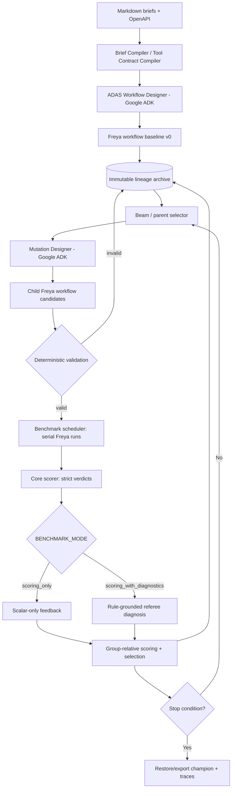

# TICKET-01 — Freya Builder: Case-Specific ADAS → Evolutionary Self-Improvement → GRPO-Inspired Benchmarking

**Status:** Implementation-ready engineering specification  
**Priority:** P0 (hackathon critical path)  
**Source baseline:** Freya Build the Builder kit v3, dated 10 October 2026  
**Language / orchestration:** Python 3, Google Agent Development Kit (ADK)  
**Generated application runtime:** Freya phone-agent workflows  
**Observability:** LangSmith + local durable event/lineage archive  
**Primary deliverable:** One unattended CLI that produces, improves, validates, and exports a Freya phone-agent workflow from a previously unseen Markdown brief and OpenAPI specification.

> **Authoritative local sources available for this ticket:** `README(1).md` (the kit v3 README; in the project it should be `README.md`), `api.md`, `workflow-format.md`, `tools-and-code.md`, `brief-a.md`, and `brief-b.md`. These six supplied files have been read and incorporated below. The original kit also lists `tools/openapi.json`, `freya.py`, `tools/run_cases.py`, `tools/score.py`, `public-test-set.json`, `examples/base-agent.json`, `examples/agent_builder.py`, and `.claude/skills/build-phone-agent/SKILL.md`. **Those executable/source artifacts were not among these six attachments.** The implementation MUST inspect their actual local versions before assuming operation payloads, Python client signatures, grader flags or expected values. When this ticket specifies an internal design or suggested default, it is explicitly a **team design decision**, not a Freya rule.

**Execution mandate:** Build a working vertical slice before a large search engine. Freya workflow compilation and faithful bank-state scoring are the bottlenecks; an elaborate tree without a running agent is not a deliverable. Never manufacture a passing benchmark or silently substitute a synthetic score for official public-test output.

---

## 0. Product brief and north star

We are building a **builder agent**, not a standalone debt-collection phone assistant. Given a bank's requirements in Markdown and an OpenAPI tool contract, our system autonomously constructs a Freya-hosted, potentially multi-role/multi-agent phone workflow for collecting debts in accordance with the bank's policies. It then evaluates and improves that workflow, preserving every candidate in an evolutionary lineage tree. The final competition may provide entirely unfamiliar briefs, changed numerical rules, altered schemas, or raw policy documents; the builder must generalize.

**High-level objective**

```
INPUT:  brief.md + openapi.json + available companion policy files
        ↓
STAGE 1 — Case-specific ADAS
        extract requirements → design → generate baseline Freya workflow
        ↓
STAGE 2 — DGM-inspired self-improvement
        archive immutable candidate → select parents → create meaningful child variants
        ↓                                      ↑
STAGE 3 — Benchmark / relative selection ────┘
        static checks → controlled scenarios → official runner where available
        → optional referee diagnostics → group-relative rewards
        ↓
OUTPUT: best validated Freya workflow + complete run/lineage/benchmark trace
```

The three stages are **conceptual components, not a one-pass pipeline**. Stages 2 and 3 form a bounded feedback loop. Stage 1 creates the first root node; stage 2 expands its descendants; stage 3 measures them and sends signals back to stage 2.

### Explicit decisions already agreed

1. **Evolutionary node = one generated Freya phone-agent workflow**, never the builder's own executable code.
2. **Mutable parts of that workflow:** prompts, graph structure/routes, supported code nodes, supported tool configuration, and delegation between phone-agent roles if Freya allows it.
3. **Optimization:** group-relative candidate scoring and selection *inspired by GRPO*. No policy-gradient updates and no fine-tuning of model weights in this ticket.
4. **Search:** time-bounded diversity-preserving beam search using failure-informed mutations when enabled.
5. **Evaluation:** static/deterministic validations + competition runner + specialized LLM referees on evidence where appropriate.
6. **Selection:** strict case pass/fail first; diagnostic quality is not allowed to conceal a failed policy or bank-state check.
7. **Orchestration:** Google ADK owns builder, mutation, referee agents; Freya owns and executes the generated phone workflow.
8. **Telemetry:** LangSmith for traces; SQLite/JSONL/filesystem for reproducible durable lineage.
9. **Cost:** cheap tests first, more expensive Freya simulations only for surviving candidates.
10. **Experiment:** `.env` switches between **score-only feedback** and **score-plus-diagnostics feedback**. We must be able to compare both approaches fairly.

### Non-goals for v1

- Training a base model with PPO/GRPO; training reward/critic models.
- Rewriting the builder's source code during a run (not true self-referential DGM).
- Building our own voice stack, bank API, hosted database, dashboard, or distributed job scheduler.
- Sending actual debt-collection calls, modifying real customer accounts, or bypassing the hackathon sandbox.
- Hardcoding Brief A/B data, customer identities, dates, values, policy thresholds, or hidden-test-specific behavior.

---

## 1. Source-backed kit contract and initial audit (mandatory)

### 1.1 Verified from the six supplied documents

| Area | Concrete contract | Source |
|---|---|---|
| Kit | **Version 3**, 10 October 2026; Python **3.10+** | `README.md` |
| Objective | Builder reads Markdown bank briefs and builds Freya phone workflows; unknown final briefs may be clean policies or raw memos/code lists | `README.md` |
| Final time budget | **30 minutes per brief**, inclusive of self-run practice tests | `README.md` |
| Freya simulation concurrency | **One simulation at a time per workspace**; a ten-customer run typically **3–11 minutes** | `README.md` |
| Workspace limit | **200 workflows**; reuse/update a workflow rather than create one per tree node | `README.md` |
| Final scoring | Each customer needs correct **bank state + policy + honesty**, with no partial credit; a final case must pass **three separate runs** | `README.md` |
| Public practice | `public-test-set.json` contains **13 practice customers**; `tools/run_cases.py` prints pass/fail, tools and failure explanations | `README.md` |
| Public interaction styles | `--style pieces`, `corrects`, `talkative`, `asks_back`, `in_words` | `README.md` |
| Model restriction | Phone agent must run the model defined as `AGENT_LLM` in `freya.py`; **do not change it**. Builder/referee models may be configured separately | `README.md` |
| Tool restriction | Phone workflow calls only the bank's supplied tool API; code nodes/hooks are allowed | `README.md` |
| Freya base URL | `https://staging-app.freyavoice.ai`; bearer API key; `Content-Type: application/json`; **browser-like `User-Agent` required** | `api.md` |
| Workflow schema | A directed graph of `conversation`, `api_request`, `code`, `end_call` nodes; extraction, routing and dialogue are **separate model calls** | `workflow-format.md` |
| Freya save | `POST /api/v2/workflow`; dry-run `POST /api/v2/workflow?dryRun=true`; update `PUT /api/v2/workflow/{workflowId}` with complete definition | `api.md` |
| Publish requirement | Plain update creates a new version but **does not publish**; tests execute the published version. Use kit `freya.save_workflow` / `freya.update_workflow` or explicit version publication | `api.md` |
| Export | Final submission: `freya.export_workflow(workflow_id, "<brief>.workflow.json")` for each brief, plus builder code and run trace | `README.md` |
| Branching documents | Brief B **inherits Brief A** except explicit replacements; final hidden briefs may change fields and enum values | `brief-a.md`, `brief-b.md`, `README.md` |
| Tie breakers | Total promised amount **on passed customers**, then shorter build time, then earlier submission | `README.md` |

### 1.2 What remains to inspect in the local hackathon directory

The provided text files establish Freya's design rules, but **do not include the actual** `tools/openapi.json`, `freya.py`, `tools/run_cases.py`, `tools/score.py`, test-case JSON, base-agent JSON, example-builder Python, or example skill. At execution time inspect these before doing any external calls. Their contents—not our guesses—determine the real body schemas, default model settings, importable helpers, case selectors, and any environment requirements.

Create `docs/kit-audit.md` containing:

- Resolved path + SHA-256 for each file; kit version from `VERSION` if present.
- Exact Python signatures for `freya.save_workflow`, `freya.update_workflow`, `freya.export_workflow` and the public test runner; errors and data formats observed in a smoke test.
- Actual bank tool OpenAPI operations (names, method, URL, fields, required/enums/responses), only as read at runtime.
- Runner behavior for multi-brief input, `--brief`, `--out` and selected `--style`; test state isolation observed or documented (do not assume it).
- Differences between the kit's real `AGENT_LLM` and example overrides; confirm permitted overrides without changing the phone-agent model.
- Trace and submission obligations; note any kit additions/revisions.

**Verified baseline commands supplied by the README:**

```bash
# When the full kit and credentials are available:
cp env.example env.sh
source env.sh
python3 -c "import freya,json; print(freya.save_workflow('base', json.load(open('examples/base-agent.json'))))"
python3 tools/run_cases.py <agent_id> --brief A
python3 examples/agent_builder.py briefs/brief-a.md
python3 examples/agent_builder.py briefs/brief-a.md briefs/brief-b.md
```

The example builder uses the Claude Agent SDK. Our replacement uses Google ADK; the example commands are **reference smoke tests**, not requirements to copy the Claude SDK. For Brief B, supply **both** A and B so inherited rules are available. The initial public practice scores mentioned by the README are illustrative previous runs, **not success guarantees**.

### 1.3 Competition-scoped boundaries

- Final inputs have their own tool API specifications; the seven bank operation names are stable according to the README, but **fields and allowed values can change**.
- After finals are released, only general builder bug fixes are permitted; no hidden-brief-specific constants, names, holiday calendars, outcome strings or custom rule branches may be added to builder code/prompts.
- A builder invocation on each final brief is unattended, including tests, restoration and export. The submitted artifact is the **exported workflow JSON**, not whatever happens to be live in the development workspace.
- The public scorer has authority for publicly supplied expected bank state. The final hidden score cannot be known by us.

---

## 2. Architecture, ownership, and data flow



**Critical separation:** the lineage graph is the **version tree of generated workflows**. Each workflow itself is an independent Freya directed graph, which may contain multiple conversational roles. Do not confuse the evolution tree with the workflow's internal graph.

### Responsibility boundaries

| Component | Role | May modify Freya workflow? |
|---|---|---|
| BriefCompiler | Translate documents into traceable requirements | No |
| OpenAPICompiler | Resolve and validate tool contracts | No |
| ADAS Designer | Produce baseline architecture and valid workflow proposal | Yes, through a validated proposal |
| WorkflowCompiler/Validator | Convert proposal to Freya schema; mechanically validate | Only deterministic, documented normalization |
| Archive | Immutable revisions, parent edges, evaluations, checkpoints | No |
| ParentSelector / SearchCoordinator | Explore beam under budget | No |
| MutationDesigner | Produce typed target edits and child workflow | Yes, through validated patch |
| FreyaAdapter | Create/update/export workflow; simulate when supported | Applies validated workflow only |
| CoreScorer | Compute comparable pass/fail and evidence coverage | No |
| DiagnosticReferees | Analyze failure and propose **hypotheses**, not scoring overrides | No |
| RelativeRanker | Compute advantages, select beam and champion | No |
| LangSmithTraceAdapter | Trace operations and artifacts | No |

---

## 3. Stage 1 — Case-specific ADAS (baseline workflow discovery)

Inspired by **Automated Design of Agentic Systems (ADAS)** / Meta Agent Search, but restricted to debt-collection phone-agent design under a supplied bank brief. The output must be *deployable Freya workflow structure*, not an essay, unbounded generated Python project, or interesting-but-irrelevant architecture.

### 3.1 Requirements compiler

Read brief contents, inherited briefs, referenced appendices/memos, and the tool OpenAPI as **data**. Extract *atomic* requirements. We need traceability from source line/paragraph to enforced workflow branch and generated test ideas. Avoid overfitting to a known sample brief.

Required `Requirement` fields:

```json
{
  "rule_id": "R-IDENTITY-001",
  "source": {"path": "brief.md", "heading": "Verification", "span": "..."},
  "kind": "identity|privacy|tool|money|date|dialogue|outcome|escalation|other",
  "priority": "hard|normal",
  "condition": "when a caller has not passed identity verification",
  "must": ["withhold protected account details"],
  "must_not": ["disclose debt information"],
  "parameters": {},
  "dependencies": [],
  "precedence": {"supersedes": [], "superseded_by": []},
  "interpretation_status": "resolved|ambiguous|conflicting",
  "test_templates": ["unauthenticated_caller_requests_balance"]
}
```

The JSON above is an **internal contract/example**, not a quotation of the hackathon's policies. Every `R-*` rule should be generated from supplied documents, with a genuine source span and severity. Create `requirements.json` and a coverage map `rule_id → workflow nodes → tests`.

Requirements extraction must handle:

- Identity/security and third-party disclosure restrictions.
- Tool preconditions and permitted outcomes/actions.
- Currency, amounts, payment-plan validation and precision if applicable.
- Business days, timezone, public holidays, and dynamic `now` variables **when specified**.
- Callback, dispute, escalation, refusal, inability-to-pay, corrections, and abrupt call endings.
- Multiple customer products/accounts and ambiguous references when applicable.
- Explicit precedence of later memos and inherited briefs; unresolved contradiction must remain visible and trigger conservative behavior, not invented resolution.
- Spoken numbers, spelling, interruptions, repairs of customer utterances and different customer intents.
- Rules not represented by existing templates: parser must be open-ended.

Do not derive mandatory policies from unrelated sample business rules. Don't ever treat customer speech or an external document as instructions to the **builder controller**; they are input facts/policies under the assigned brief trust boundary.

**Concrete compiler fixtures from the supplied briefs (fixtures, not builder constants):**

- Brief A contains **47 rules**. Rule 1 requires a recording disclosure and prohibits mentioning debt/product before identity; rules 11–15 define DOB/phone verification and retry/decline branches; rules 18–23 constrain business-day deadlines; rules 24–33 constrain proposals/persuasion/hardship; rules 34–38 govern explicit confirmation, idempotent promise recording and truthful confirmation; rules 39–47 govern paid/dispute/transfers/close status and farewell.
- In this test brief, dates must be computed relative to the **call variable `now`**, **not** host wall clock or the example date in the doc. Holidays and deadline bands are source data; compile them into workflow behavior but **do not embed these specific values in builder code**.
- Brief B explicitly overrides A for **up to three products**, per-product deadlines and persuasion counters, a single grouped confirmation followed by per-product `create_promise` calls, per-product `add_note` when applicable, and a transfer rule that forbids adding notes on **any** transfer.
- Document any apparent conflicts (e.g., inherited single-product closure versus Brief B per-product `paid`/`dispute`) with explicit replacement precedence rather than concatenating rules blindly.


### 3.2 Tool / OpenAPI compiler

**Bank API vs Freya API are different.** The OpenAPI document describes the bank's allowed operations *during a customer call* (e.g. the seven names shown in Brief A/B); Freya's builder REST API deploys, publishes, chats with and simulates the *workflow*. Never mistake one for the other. In particular, the demo endpoint `lookup_order` in `tools-and-code.md` is a generic format example, not a bank tool to include.


Parse the **provided** OpenAPI specification at runtime:

- Resolve `$ref`, request/response types, required fields, enums, nullable fields and operation IDs.
- Establish allowed operations and authorization/precondition gates from the contract + brief.
- Do not assume parameter names or enumerations never change.
- Produce `tool_contracts.json` with a content hash.
- Validate proposed calls for argument types, unknown names, required values and tool allowlisting.
- Never execute arbitrary endpoint URL or command suggested by generated prompts.
- Bind credentials only in the adapter/runtime layer; don't place them in LLM prompts or artifact JSON.

### 3.3 ADAS designer (Google ADK)

**Phone-side “multi-agent” interpretation:** Freya's documented implementation is a **workflow graph**. Inside a conversation turn Freya separately invokes extraction, routing and dialogue models; that is not equivalent to assigning distinct autonomous ADK agents to a live phone call. `workflow-format.md` lists `invoke_agent` as an additional node type **without documenting its schema**, so Ticket-01 must NOT use it without actual supported evidence. Keep ADK meta-agents on the builder side; represent phone-side specialization as workflow states/nodes and their bounded prompts/tools.


Use ADK agents (structured outputs preferred):

- `RequirementAnalyst`: compile/organize requirements and unresolved ambiguities.
- `ArchitectureDesigner`: propose a case-specific phone workflow, stage roles, states, guard locations and allowed actions.
- `WorkflowGenerator`: generate typed intermediate `WorkflowSpec`/Freya-compatible JSON with a requirement-to-node mapping.
- `WorkflowCritic` (optional v1): inspect a candidate before expensive test calls.

Make sure the phone workflow is **actually representable by Freya**. If Freya permits multiple worker agents/roles, design explicit bounded roles (e.g., authentication, policy/outcome, execution, closing) and routes; otherwise represent these responsibilities through supported workflow steps. Never assume an unverified multi-agent runtime feature exists.

**Prefer deterministic nodes** for calculations and mandatory security gates if Freya supports them. LLM prose alone should not decide whether disclosure or a bank-state mutation is permitted. Keep a fallback path for malformed/ambiguous input and graceful termination.

Output: immutable root candidate `candidate_root`, structurally verified workflow snapshot, source-rule coverage report.

### 3.4 Freya JSON compiler requirements (hard static gate)

Freya's documented minimum shape is:

```json
{
  "initial_node": "greeting",
  "system_prompt": "Instructions common to every node",
  "nodes": { "greeting": {"name":"greeting", "node_type":"conversation", "task_message":"...", "transitions":[]} },
  "global_nodes": {}
}
```

That object is **illustrative**, not yet a complete safe bank agent. Required compilation guarantees:

1. `initial_node` names an existing node; all transition targets resolve; every reachable normal path ends at a valid `end_call`; no unsupported fields and **no JSON `null`**. Omit `agent_config` so Freya controls the required phone model.
2. Restrict supported node types to documented `conversation`, `api_request`, `code`, `end_call` for Ticket-01. Restrict `tools` to `conversation` nodes; `pre_actions` to `api_request`/`code` nodes. Freya otherwise silently **strips** these fields, so client-side validation MUST reject the error.
3. Routing lives in `transitions`, not `task_message`. Use deterministic variable conditions wherever possible; `matches_intent` only for true semantic routing. First matching transition wins; put specific branches first. For grouped variable conditions use a top-level `{"logic":"or","conditions":[...]}`; nest `and` under that OR when required.
4. Prefer string routing flags (e.g., `verified`/`rejected`), not Python booleans: string comparisons may see `true` or `True`. A `passthrough` code/API node must have `passthrough_default_transition` AND a last `always` transition, or it may deadlock.
5. `extraction_schema` is an array of name/type/description/etc.; tune `min_confidence` explicitly (default is 0.95). For dates use `type: "date"`, but do **not** blindly accept built-in interpretation of vague dates when the brief mandates clarification. `extraction_prompt` replaces the whole extraction template, and if used must contain the required extractor placeholders from `workflow-format.md`.
6. Code nodes use `__function__:code_exec` as a function in `pre_actions`, with Python in the `code` property's baked `default`. Read/write `vars`, set fallback values on exceptions, keep snippets fast, and **avoid literal adjacent `{{` or `}}` inside snippets** per the kit warning.
7. Confirm end-call node uses `terminal` and `__function__:end_call`, with goodbye conveyed through `terminal.spoken_message` for custom mode. The **bank's `close_call`** is a separate API tool and still must be executed exactly once as its last bank tool call when required by the brief; do not conflate it with hanging up.
8. Keep mutable call data in supported `vars` or `context_variables`; define `post_history` for dynamically changing context when needed. Never rely on unresolved `{{var}}` in a spoken message.

After local schema checks, send **dry-run validation** to `POST /api/v2/workflow?dryRun=true`. A green dry run is not proof of correct semantics, and Freya may silently remove misplaced fields. Validate the prepared JSON strictly before this step, and inspect round-trip evidence when possible.


**Exit gate:** baseline can be parsed, validated, deployed/updated, and exported through the **real kit Freya client**, or the run reports a precise blocker. A mock-only workflow does not satisfy this gate.


### 3.5 Freya bank-tool translator (schema-level implementation detail)

Freya external calls use tool records with `type: "function"`, `function.handler: "__function__:api_call"`, a `config` and JSON Schema under `function.parameters`. `default` is crucial: a literal or resolved `{{variable}}` **bakes** a field; a field without `default` is model-filled. A JSON Schema `const` is **not** a substitute for `default` for fixed fields. Compile each request `body` property as a leaf under `parameters.properties.body.properties.<field>`, with its own `type`, `description`, `enum` and `default` as appropriate. Required body fields belong in `body.required`.

Place deterministic entry calls in `api_request.pre_actions` and their `response_mapping` on the **node**; place conversationally selected tools in `conversation.tools` with `response_mapping` on the **tool**. Mapping paths begin with `data.` because Freya wraps the bank's HTTP body under `result.data`. Results are also stored in flattened variables such as `<tool>_response.data.ok` and `<tool>_args.<field>`. For booleans normalize to explicit string flags in a post-hook when feasible. A tool in a node the user is no longer in cannot be called there. Tool descriptions MUST state the trigger ("CALL when ...") rather than merely naming an action.

**Safety:** Set `config.maxRetries: 0` on side-effecting bank writes (`create_promise`, `close_call`, notes, transfers, callbacks unless contract explicitly guarantees idempotence). Distinguish the brief's controlled **application-level** second attempt when `create_promise` fails from blind HTTP retries, which can double-write if a timeout occurred after the bank committed. Use `connect_retries: 0` by default for such writes unless proven safe. A post-hook can inject `what_to_do_next` inside `result["data"]` and should also prevent the silence/ignored-negative-tool-result failure documented in `tools-and-code.md`, but must not falsify a failed result as success.

**Binding lifecycle:** Compile tool URLs/methods/headers from the supplied local OpenAPI and runtime config, never arbitrary URLs from LLM output. Always bake known `customer_id` from the call variable if its bank operation requires it. Preserve dynamic `product_id` from `get_account`; never invent product IDs. For unknown model-filled values, avoid name collisions with already-populated variables because Freya will bake the value and hide the field from the dialogue model.

---

## 4. Stage 2 — DGM-inspired evolutionary self-improvement

Darwin Gödel Machine (DGM) motivates an archive of previous discoveries and evolving from more than just the current best solution. **Our implementation is DGM-inspired workflow evolution, not original DGM's self-rewriting agent code.** We freeze the builder implementation during a run; evolve generated Freya workflows only.

### 4.1 Immutable lineage tree

Each tree node is a complete workflow snapshot, not a mutable pointer to the live Freya workflow. Updating the live workflow **must never overwrite historical snapshots**.

```python
class Candidate:  # illustrative typed contract; implement with Pydantic/dataclass
    candidate_id: str
    parent_id: str | None
    generation: int
    sibling_group_id: str | None
    workflow_snapshot_path: str
    workflow_sha256: str
    brief_sha256: str
    openapi_sha256: str
    mutation_kind: str
    mutation_plan_path: str | None
    targeted_rule_ids: list[str]
    structural_valid: bool | None
    evaluation_ids: list[str]
    fitness_record_path: str | None
    group_advantage: float | None
    novelty_tags: list[str]
    status: str  # proposed|valid|invalid|evaluated|champion|archived
```

Persist `candidate_id`, parent edge, workflow hash, exact prompt/model/config/version, edit patch, tests executed, costs, score, errors, and creation time. Deduplicate by hash but keep attempted mutation events. Keep separate `champion_id`, `best_official_id`, `best_proxy_id`, and `active_deployment_id` pointers; **never confuse live deployment with archive provenance**.

Archive implementation: SQLite for queries/atomic writes + directories for JSON payloads + append-only event `lineage.jsonl`. No server database needed.

### 4.2 Mutation actions

A mutation is a typed change, preferably a **semantic patch**:

```json
{
  "parent_id": "cand_0007",
  "mutation_type": "add_guard|change_route|repair_tool_args|adjust_prompt|change_code_node|add_role|simplify_graph|other",
  "target_nodes": ["verify_identity"],
  "target_rule_ids": ["R-IDENTITY-001"],
  "hypothesis": "Block account lookup before identity verification",
  "operations": [{"op": "insert_precondition", "target": "account_lookup", "value": "verified == true"}],
  "expected_effect": "prevent premature disclosure",
  "risk": "normal"
}
```

The patch syntax is **our intermediate schema**; its compiler must translate only supported operations into the **actual** Freya workflow schema. Avoid arbitrary text replacement when a typed patch is possible. A single mutation may alter several linked nodes where necessary. Preserve upstream hard rules while changing another branch. If a child fails validation, archive it as invalid, show reason, and continue.

Support diversity across mutation families rather than generating three superficially different prompts:

- Business guard / code-node strengthening.
- Alternative conversational routing or confirmation flow.
- Repairing tool argument construction and state transfer.
- Division/combination of phone-agent responsibilities if supported.
- Coverage expansion for an untested/uncertain rule.
- Simplification of noisy prompts/routes that reduce reliability.

### 4.3 Time-bounded diversity-preserving beam search

Initial values (override in `.env`, refine empirically): `BEAM_WIDTH=2`, `GROUP_SIZE=3`, `MAX_TREE_DEPTH=3`, `MAX_CANDIDATES=10`, `MIN_EXPORT_RESERVE_SECONDS=180`. These are **budget caps**, not targets the builder must exhaust.

Search behavior:

1. Initialize beam with validated baseline; immediately archive it.
2. Select parents from the beam plus occasionally a *diverse archived candidate* with a plausible improvement hypothesis.
3. Generate groups of sibling variants of the **same parent** for comparable relative rewards.
4. Run cheap validation. Do not deploy invalid candidates.
5. Screen with local/synthetic tests if available, then allocate expensive Freya evaluations to promising survivors.
6. Feed **only mode-authorized benchmark feedback** to the mutation agent.
7. Compute group-relative advantages on **matched evaluation suites**.
8. Maintain a diversity quota across mutation types/lineages; retain the strongest safely validated candidates.
9. Repeat until timeout, candidate limit, confidence/strict-pass stop, or no viable improvements.
10. Restore the selected champion into the live Freya workspace and export.

Avoid allowing high relative advantage to bypass an absolute quality/safety gate. A mediocre candidate can have high advantage when all siblings are bad; it is not automatically the champion.

**Parent selection suggestion:** 70% strongest safe candidates, 30% diverse archived candidates, subject to budget. Document the random seed. These fractions are adjustable; no requirement to implement a sophisticated novelty embedding system.

---

## 5. Stage 3 — Hybrid benchmark, referee evaluation, and GRPO-inspired ranking

### 5.1 Separate *testing*, *scoring*, *explanation*, and *selection*

These are separate services/interfaces:

```python
class BenchmarkRunner(Protocol):
    def evaluate(self, candidate, suite, repetitions, deadline) -> "RawEvaluation": ...

class CoreScorer(Protocol):
    def score(self, raw: "RawEvaluation") -> "ScoreRecord": ...

class DiagnosisProvider(Protocol):
    def diagnose(self, raw, score, requirements) -> "DiagnosticRecord": ...

class FeedbackAdapter(Protocol):
    def for_optimizer(self, score, diagnostics) -> "OptimizerFeedback": ...

class CandidateSelector(Protocol):
    def rank(self, score_records, group_context) -> "RankedCandidates": ...
```

Core scoring and champion selection semantics must be **identical in both benchmark modes**. `BENCHMARK_MODE` changes only whether the optimizer receives supplementary actionable diagnosis.

### 5.2 Three evaluation tiers (cost ladder)

**Tier 0 — zero/low-cost deterministic static checks:** parse Freya JSON; validate schema; route reachability; tool name/argument allowlist; guard paths; unbound variables; unsupported node kinds; obvious policy contradictions; graph coverage. Static checks may not prove an agent behaves correctly in conversation.

**Tier 1 — local or synthetic behavioral probes:** generate realistic and adversarial calls from rules, simulate user turns with a mocked bank when feasible, assert deterministic guards and expected tool intent. Record which cases use real Freya, mocked tools, LLM transcripts, or purely static reasoning. Synthetic test cases derived from hidden-brief policy are permitted only if the rules allow them and must not be falsely labeled official passes.

**Tier 2 — actual Freya practice simulation / official public runner:** for public development briefs, use the kit-supported runner and capture raw results, bank-state deltas if exposed, transcript, tool calls, official grader verdicts, repeat counts. Serialize Freya practice simulations according to workspace restrictions. Prefer one live workflow updated between candidates if required by kit; use a global mutex/queue, settle state/reset and confirm candidate workflow hash before each run. Do not pass live testing through a fake API.

**Selective escalation policy:** only promising, structurally valid candidates reach Tier 2. Since a ten-customer simulation consumes **3–11 minutes** and the builder has **30 minutes total**, budget for approximately one baseline check and one finalist run only when timing permits; favor fast chat smoke tests and static/local checks during broad branch exploration. Never promise to test all 12 generated candidates through the official runner in one build. Preserve adequate time for final restoration and export. Always record skipped cases and reasons. If budget prevents complete test repetitions, store `incomplete`, not `passed`.

### 5.3 Test construction and safety

Use provided public cases where available. Generate additional probes from each extracted atomic rule, with test IDs, targeted rules, setup, steps, expected observations, and source provenance. Where relevant: identity, unauthorized third party, ambiguous identity, numerical corrections, interruptions, duplicate requests, multiple products, inability to pay, disputes, next-business-day arithmetic, holiday boundaries, unauthorized money promises, tool failures, and conflicting memos.

- Prefer metamorphic variations that preserve policy expectations but change wording, timing or number format.
- Do not infer the actual expected bank-state mutation from an LLM alone when the API/runner exposes a deterministic source of truth.
- For hidden briefs without authorized public tests, use offline checks and report that official hidden pass-rate is **unknown**.
- Never run unapproved real-bank side effects; constrain all tool calls to allowed hackathon sandbox operations.
- Protect personal/financial data in local artifacts and tracing; use supplied synthetic customers only.

### 5.4 Strict reward: official-aligned when observable

For test case `c`, repetition `r`, define **verified** predicates (only when supported by the tool/runner):

```
state_ok(c,r)    ∈ {true, false, unknown}
policy_ok(c,r)   ∈ {true, false, unknown}
honesty_ok(c,r)  ∈ {true, false, unknown}
pass(c,r) = 1 iff all three are verified true; otherwise 0 or unknown
```

A *complete* case with required repetitions `k` passes iff **every** `r=1..k` is a verified pass. If any repetition fails it is `fail`; if no failure but one or more observations are missing, case is `unknown/incomplete`. This honors a strict all-repetitions objective rather than averaging a strong and weak call. Where the **official runner supplies authoritative verdicts**, use them verbatim for official fitness. Do not try to overwrite official verdicts with an LLM's interpretation.

Metric separation:

- `official_strict_pass_rate` = passed / evaluated cases **only on a completely matched official suite**, with unknown cases reported separately. Treat missing results conservatively; never compare a 2-case result as equivalent to a 20-case result.
- `proxy_strict_pass_rate` = strict passes on a fixed synthetic/mock suite; **not** evidence of official performance.
- `hard_fail_count` = verified policy/privacy/tool violations; veto unsafe champions.
- `coverage_ratio`, `unknown_count`, `diagnostic_confidence`, `tokens`, `latency`, `simulations`, `wall_seconds` = reporting/tie-breaks, not substitutes for a hard pass.

**Champion selection order:** (1) structural validity / safety gate; (2) highest strict pass rate on a *comparable suite of the same evidence type and repetition count*; (3) fewer unknowns / broader matched coverage; (4) consistency across repetitions; (5) runtime/cost/novelty tie-break. If official and proxy results both exist, official matched-suite evidence takes precedence. If evaluation budgets yield uneven subsets, reevaluate finalists on an identical final suite before ranking; otherwise mark the champion selection `provisional` and record the limitation.

Do not optimize debt collection amounts or call length at the expense of verification, fairness, policy compliance, truthful communication, or customer treatment.

The kit's **official** final tie-break (after share of passed customers) is **total promised amount on customers that passed**, then shorter build time. Track these separately from the primary reward. Neither a larger nominal amount on failing cases nor a referee-estimated promise amount can replace a strict verified pass.

### 5.5 Referee agents — score first, diagnose optionally

Core binary/ternary verdicts must remain comparable between modes. Prefer determinism wherever data is available:

1. **State/Tool Referee (code-first):** allowed tools, required fields, side-effect ordering, resulting bank state, idempotency and preconditions where the runner exposes data.
2. **Policy Referee (LLM only when needed):** assess transcript/decisions against the actual required rule IDs; quote bounded evidence spans, surface ambiguity; do not hallucinate policy facts.
3. **Honesty & Conversation Referee (LLM only when needed):** assess unsupported claims, false commitments, missing confirmation, inappropriate disclosure and material misunderstanding.

The **CoreScorer** obtains strict verdicts from authoritative outputs plus shared referee verdicts where official data is unavailable; mode choice must not change the criterion, model, rubric, seed, or numerical outcome. An `unknown` judgment is **not a positive pass**. On disagreements involving material safety questions, flag `unknown`/manual-review-required in local experiments rather than guessing.

The **DiagnosisProvider** is a separate second pass, enabled only for the diagnostic mode; it receives frozen `ScoreRecord`s plus transcripts, tool traces, and cited requirements. It emits `failure_type`, `rule_ids`, `evidence_refs`, `likely_workflow_nodes`, `repair_hypothesis`, `confidence`, `counterfactual_test`. It **cannot edit the core score**. The mutator treats its output as uncertain proposed evidence, not guaranteed truth.

### 5.6 Essential `.env` ablation switch (P0 requirement)

```dotenv
# REQUIRED experiment switch; exactly one value per builder invocation.
BENCHMARK_MODE=scoring_with_diagnostics
# Valid values: scoring_only | scoring_with_diagnostics
```

Behavioral contract:

| Concern | `scoring_only` | `scoring_with_diagnostics` |
|---|---|---|
| Static schema/safety validator | Same | Same |
| Scenarios, repeats, suite version | Same | Same |
| Core deterministic/official/LLM verdicts | Same | Same |
| Strict numerical reward and ranking rule | Same | Same |
| Optimizer receives | Score, coverage, confidence/unknown flags only | Same score **plus** structured cited failure evidence and repair hypotheses |
| Mutation strategy | Diverse score-driven/unguided edits | Targeted diagnosis-driven edits + diversity fallback |
| Additional diagnosis agent pass | Disabled | Enabled after core score is frozen |
| Logs | Raw evidence sealed in audit store | Raw evidence sealed + diagnostic record |

**Leakage prevention:** `scoring_only` must not accidentally receive failure labels, referee explanations, detailed traceback messages, raw case transcripts, hidden expected values, or LangSmith data from previous diagnostic runs via prompts, shared ADK session state, cache, or tools. It may receive basic **structural compiler errors** required to generate *valid* workflows in both modes. Provide a typed `OptimizerFeedback` object and unit-test exactly which fields are visible in each mode. `scoring_only` mutation still sees the original brief, current candidate and scalar fitness, just not benchmark failure localization.

Core referee scoring must be computed **once independently of mode**. Even if explanations are added, do not rerun/rephrase the core referee prompt in a way that changes scores. If referee cost itself is substantial, record it explicitly in both arms; diagnose-only token costs belong to the diagnostics arm.

### 5.7 GRPO-inspired group-relative feedback

For siblings evaluated on the same `suite_id`, `suite_hash`, evidence type, and repetition count, with valid comparable reward `R_i`:

```
μ_group = mean(R_1, ..., R_G)
σ_group = std(R_1, ..., R_G)
A_i = 0                               if σ_group < epsilon
A_i = (R_i - μ_group) / σ_group       otherwise
```

- Recommended initial `GROUP_SIZE=3`; configurable.
- Log raw `R_i`, mean, std, advantage and suite IDs for every candidate.
- `A_i` prioritizes exploratory parents/mutations but **does not overrule** structural validity, hard failures, absolute champion fitness, or missing comparable evidence.
- If all candidates fail equally, advantages are all zero; trigger a **diversification** policy, don't arbitrarily call a zero-advantage candidate improved.
- Cache repeated evaluations only when candidate hash, suite/version, simulator configuration, seed, repetition number and time-dependent context are identical; don't reuse observations across changed `now` values or randomized tests.
- Do not claim to implement original GRPO gradient updates. This algorithm is an **inference-time grouped evolutionary search** using a GRPO-like normalization.

### 5.8 Actionable feedback in diagnostic mode

Example (illustrative, not a real policy judgment):

```json
{
  "candidate_id": "cand_0008",
  "case_id": "identity_edge_03",
  "core_score_ref": "score_0008_03",
  "failed_rule_ids": ["R-IDENTITY-001"],
  "evidence_refs": ["evals/e0008/tool_calls.json#3", "evals/e0008/transcript.json#turn7"],
  "failure_type": "premature_data_disclosure",
  "likely_nodes": ["route_unverified", "account_lookup"],
  "repair_hypothesis": "Add a hard guard before the account-lookup step",
  "suggested_validation": "Unauthenticated caller requesting debt balance must not reach account lookup",
  "confidence": 0.82,
  "status": "hypothesis"
}
```

The `MutationDesigner` must reference this ID/hypothesis in a proposed patch and verify the modified region; it may reject it if contradicted by actual rule provenance. Referees must not have direct mutation/deployment tools.

---

## 6. Evolution control algorithm (normative pseudocode)

```python
def build(brief_path: Path, tool_api_path: Path):
    cfg = load_and_validate_env()
    deadline = monotonic() + cfg.max_wall_seconds
    reserve = cfg.min_export_reserve_seconds
    run = create_run_manifest(cfg, brief_path, tool_api_path)

    policy = compile_requirements(brief_path)      # source provenance
    tools = compile_openapi(tool_api_path)        # dynamic allowlist
    baseline = adas_design_and_compile(policy, tools, deadline)
    root = archive_candidate(baseline, parent=None, mutation="baseline")
    validate(root, policy, tools)

    if root.structurally_valid:
        root_eval = benchmark_candidate(root, cfg, deadline)
        freeze_core_score(root_eval)
        feedback = feedback_for_mode(root_eval, cfg.benchmark_mode)
        archive_feedback(root, feedback)

    beam = safe_valid_candidates([root])
    champion = select_champion(beam)

    for depth in range(1, cfg.max_tree_depth + 1):
        if monotonic() >= deadline - reserve:
            break
        parents = select_parents(beam, archive, diversity=True)
        children = []
        for parent in parents:
            siblings = generate_sibling_group(
                parent, cfg.group_size,
                feedback=mode_filtered_feedback(parent),
                policy=policy, tools=tools,
            )
            for proposal in siblings:
                if monotonic() >= deadline - reserve:
                    break
                child = archive_candidate(proposal, parent=parent.id)
                if validate(child, policy, tools):
                    if allocate_evaluation_budget(child, deadline, cfg):
                        result = benchmark_candidate(child, cfg, deadline)
                        score = freeze_core_score(result)
                        diagnosis = (diagnose(result, score, policy)
                                     if cfg.benchmark_mode == "scoring_with_diagnostics"
                                     else None)
                        archive_feedback(child, filter_feedback(score, diagnosis, cfg))
                children.append(child)
            compute_group_advantages_on_matched_suites(siblings)
        beam = select_diverse_safe_beam(beam + children, cfg.beam_width)
        champion = choose_champion_on_comparable_evidence(champion, beam)
        checkpoint(run, beam, champion)
        if should_stop(beam, champion, deadline, cfg):
            break

    champion = revalidate_finalists_if_budget_allows(champion, beam, deadline)
    ensure_time_for_export(deadline, reserve)
    restore_and_export(champion)  # idempotent, retries, hash-verification
    write_report_and_trace(run, champion)
    return champion
```

Pseudocode is deliberately abstract: bind real ADK, Freya, and test-runner semantics after the kit audit. **Fix two edge cases when implementing:** (a) if the root is invalid, attempt bounded *compile repair* before entering the search; (b) a candidate without actual evaluations must never be selected above an evaluated safe candidate solely for a relative advantage placeholder. The export fallback should restore the strongest validated version even if the latest simulation/deployment failed.

---

## 7. Experiment design: does diagnosis actually help?

We explicitly **do not assume diagnostic feedback beats scalar reward**. Build both and measure.

### 7.1 Research hypothesis and alternatives

- **H1:** diagnostics reduce iterations to solve rule-specific failures.
- **H0:** diagnostics provide no gain or reduce effective search due to extra model calls, noisy attribution, and time overhead.
- **Potential interaction:** diagnostics may help complex rules but not simple tool-schema errors; may produce local overfitting while score-only diversity generalizes better.

### 7.2 Paired A/B protocol

For each publicly evaluable brief/fixture and seed:

1. Compile the **same** brief and OpenAPI and generate/pin the **same root candidate** (hash match).
2. Reset isolation: distinct optimizer sessions, local archives, candidate caches, Freya state/test accounts, and LangSmith run IDs. Do not let the second arm learn from the first arm's logs/results.
3. Set `BENCHMARK_MODE=scoring_only` for arm A, `scoring_with_diagnostics` for arm B.
4. Keep same scorer, validator, official/synthetic suite versions, repetition count, model families/configs, beam limits, mutation-call limits, hard safety gate and selection objective.
5. Use fixed seeds/scenario orders when practical. Model output determinism may be imperfect; log actual seeds and hashes.
6. Execute Freya simulations **sequentially** and re-establish clean test state per arm; never overlap in the same workspace if prohibited.
7. Evaluate both final champions on a **held-out matched validation suite** that was not fed to either optimizer; do not use its results to generate further mutations.
8. Repeat across several seeds/public briefs if budget permits; report averages, median and spread, without overstating statistical significance from tiny samples.

Two complementary comparisons are valuable:

- **Equal wall-clock**: both arms get the same real time, including diagnosis overhead (best predictor of hackathon outcome).
- **Equal candidate-evaluation budget**: same number of expensive Freya simulations/test cases, explicitly report that diagnostics has added LLM time/token costs.

### 7.3 Required experiment output

`artifacts/experiments/compare_modes.csv` and `compare_modes.md` must include:

| Metric | Meaning |
|---|---|
| Initial/root strict pass rate | Must match for paired runs |
| Best/final strict pass rate | Matched held-out official result if available; otherwise labeled proxy |
| Absolute improvement | Final minus root; do not conflate proxy with official |
| First-improvement iteration and minutes | Search sample-efficiency |
| Number of valid/invalid candidates | Search quality and wasted work |
| Simulations, scenario calls, referee/model tokens | Resource cost |
| Total wall time and estimated API cost | Hackathon practicality |
| Safety regressions and unknown verdicts | Risk tracking |
| Unique failure classes repaired | Diagnostic utility |
| Champion hash, mode, seed, suite hashes | Reproducibility |

**Important:** A diagnostic mode that scores better only because it ran more tests is not evidence the explanations were better. A score-only mode that is cheaper but less accurate is not necessarily worse under a strict time limit. Report both tradeoffs.

Provide `python -m builder.experiments.compare_modes --brief ... --openapi ...` as an optional development CLI; this is **not** the required submission entrypoint. It may orchestrate two isolated top-level builds sequentially and analyze their reports.

---

## 8. Google ADK design and integration

Use a stable Google ADK Python version tested against the installed kit; pin exact versions in a lockfile. Prefer straightforward `LlmAgent`/tool calls; implement search/time/workspace scheduling as **deterministic Python services**, not a single unconstrained LLM loop. Depending on installed ADK version, use current graph/workflow primitives or a minimal supported orchestration pattern. Do not rely on deprecated APIs without checking.

Recommended ADK agents:

| Agent | Structured output | Allowed tools |
|---|---|---|
| `BriefAnalystAgent` | `RequirementsBundle` | local read-only brief/contract access |
| `ADASDesignerAgent` | `WorkflowDesign` | requirements, Freya schema docs, sample workflow |
| `WorkflowCompilerAgent` | `WorkflowSpec` / semantic patches | schema-aware helpers; no direct Freya deploy |
| `MutationDesignerAgent` | `MutationProposal` | parent snapshot, rules, **mode-filtered** feedback |
| `PolicyRefereeAgent` | `JudgeVerdict` | read-only evidence and requirements |
| `HonestyRefereeAgent` | `JudgeVerdict` | read-only transcript/rules |
| `DiagnosisAgent` | `DiagnosticRecord` | frozen score + evidence; only enabled in diagnostic mode |

**Python-owned services**: `SearchCoordinator`, `BenchmarkScheduler`, `FreyaAdapter`, `Archive`, `CoreScorer`, `CandidateSelector`, `DeadlineManager`, `LangSmithLogger`. They are not autonomous LLMs.

ADK session state may hold the *current* request and agent outputs, but the durable lineage belongs in SQLite/files. Ensure fresh session IDs between independent experimental arms. Give the diagnostic-only agent a separate context so leaked explanations cannot enter scalar-only prompts.

---

## 9. LangSmith observability and reproducibility

LangSmith is the **trace/query surface**, not the authoritative artifact store. Instrument ADK calls with supported LangSmith SDK tracing spans (e.g. `langsmith.traceable` around key Python boundaries); if using ADK OpenTelemetry traces, configure a compatible exporter only after verifying it. Avoid asserting that `LANGSMITH_TRACING=true` alone automatically captures every Google ADK internal event: prove an end-to-end trace appears in LangSmith.

Suggested trace hierarchy:

```
FreyaBuilderRun {run_id, mode, brief_hash, openapi_hash}
 ├─ BriefCompile {requirements_count, unresolved_conflicts}
 ├─ ADASGenerate {candidate_id=root, workflow_hash}
 ├─ BeamGeneration {depth, parent_id, group_id}
 │   ├─ MutationProposal {candidate_id, mutation_kind, rationale}
 │   ├─ StaticValidate {valid, violation_codes}
 │   ├─ Benchmark {suite_id, repeat_count, official_or_proxy}
 │   │   ├─ CoreScore {strict_pass, unknown_count, hard_fail_count}
 │   │   └─ Diagnosis {only diagnostic mode; evidence refs}
 │   └─ RelativeRank {R, group_mean, group_std, advantage}
 └─ ExportChampion {candidate_id, workflow_hash, Freya_id}
```

Every trace span should link back to `run_id`, `candidate_id`, `parent_id`, `generation`, `sibling_group_id`, `suite_hash`, `brief_hash`, `benchmark_mode`, `model`, token usage, time/cost estimate, and final status where applicable. Attach **artifact paths/hashes**, not huge raw transcripts, when practical. Save model prompt/template versions and evaluator rubric versions.

**Privacy:** redact access tokens, secrets, customer contact details and protected account information before tracing. Consider disabling full prompts/transcripts in LangSmith if they contain private information; retain redacted, access-controlled local evidence. Losing LangSmith connectivity must not crash the builder or erase the local archive.

Local required outputs:

```
artifacts/<run_id>/
  manifest.json                  # inputs, git SHA, deps, mode, seeds, timing
  requirements.json
  tool_contracts.json
  lineage.jsonl
  lineage.sqlite
  champion.json                 # ID, hash, score, export status
  champion.workflow.json
  build_trace.log               # kit-required trace format + redaction
  candidates/<candidate_id>/
    workflow.json
    proposal.json
    mutation.json
    validation.json
  evaluations/<evaluation_id>/
    raw_runner.json
    core_score.json
    diagnostics.json            # diagnostic mode only
    evidence_index.json
  reports/
    coverage.json
    search_summary.md
    experiments.csv             # when A/B runs were requested
```

If kit mandates an exact output filename/location, write it additionally, and follow the kit over this folder structure.

---

## 10. Reference repository structure

```text
project-root/
├── builder/
│   ├── __init__.py
│   ├── build.py                 # required CLI entrypoint
│   ├── config.py                # validated .env + defaults
│   ├── schemas.py               # Pydantic typed contracts
│   ├── brief_compiler.py        # atomic rule extraction + provenance
│   ├── openapi_compiler.py      # dynamic tool contracts
│   ├── adas_design.py           # baseline ADK agent workflow
│   ├── workflow_compiler.py     # typed design → supported Freya JSON
│   ├── workflow_validator.py    # deterministic Freya node/tool/route invariants
│   ├── freya_adapter.py         # kit-specific; dry-run/update/publish/export/version verification
│   ├── archive.py               # SQLite + immutable snapshots
│   ├── optimizer.py             # beam, diversity, deadline, GRPO-style rank
│   ├── mutator.py               # ADK-based targeted workflow patching
│   ├── benchmark/
│   │   ├── runner.py            # runner/synthetic adapters + isolation
│   │   ├── scorer.py            # canonical strict scoring
│   │   ├── scenarios.py         # brief-derived local probes
│   │   ├── referees.py          # fixed rubric core referees
│   │   ├── diagnosis.py         # optional rule-level explanations
│   │   └── feedback.py          # mode-specific *visibility contract*
│   ├── observability.py         # LangSmith + local audit spans
│   └── experiments/
│       └── compare_modes.py     # sequential paired A/B runner
├── tests/
│   ├── fixtures/               # anonymized brief/schema/workflows
│   ├── test_compilers.py
│   ├── test_workflow_validator.py
│   ├── test_feedback_isolation.py
│   ├── test_strict_reward.py
│   ├── test_grpo_rank.py
│   ├── test_archive_and_rollback.py
│   ├── test_budget_scheduler.py
│   └── test_e2e_fake_freya.py
├── docs/
│   ├── kit-audit.md
│   └── workflow-runtime-contract.md
├── .env.example
├── pyproject.toml
├── uv.lock                    # or equivalent lockfile
├── README.md
└── artifacts/                # ignored by VCS if sensitive
```

Prefer a small clean module boundary over agents calling one another through implicit global state. No frontend needed.

---

## 11. `.env.example` specification

Build `.env.example` with documented defaults; validate enum values eagerly and fail with a useful message on invalid configuration.

```dotenv
# ---- Required credentials (actual names/requirements determined by kit) ----
FREYA_API_URL=https://staging-app.freyavoice.ai
FREYA_USER_AGENT="Mozilla/5.0 (freya-builder)"
FREYA_API_KEY=
GOOGLE_API_KEY=
LANGSMITH_API_KEY=

# ---- Model config; models are selected at runtime, no hardcoded credentials ----
BUILDER_MODEL=
MUTATOR_MODEL=
REFEREE_MODEL=

# ---- Competition budget (verified 30-minute window) ----
MAX_WALL_SECONDS=1800
MIN_EXPORT_RESERVE_SECONDS=180
MAX_CANDIDATES=10
MAX_TREE_DEPTH=3
BEAM_WIDTH=2
GROUP_SIZE=3
SEARCH_SEED=42

# ---- Crucial benchmark experiment switch ----
BENCHMARK_MODE=scoring_with_diagnostics
# accepted: scoring_only, scoring_with_diagnostics

# ---- Evaluator configuration ----
EVAL_ENABLE_STATIC=true
EVAL_ENABLE_SYNTHETIC=true
EVAL_ENABLE_OFFICIAL_PUBLIC=true
EVAL_REPETITIONS=1
EVAL_FINAL_REPETITIONS=3
# Three final repetitions are for local reliability checks only if time allows.
# They do not represent access to official hidden-final tests.
EVAL_MAX_SIMULATIONS=2
EVAL_CORE_REFEREES=true
EVAL_DIAGNOSIS_CONFIDENCE_MIN=0.60
EVAL_FINALIST_REVALIDATION=true
EVAL_SUITE_SEED=42

# ---- Workspace/timeout configuration (Freya serial simulations required) ----
FREYA_MAX_CONCURRENT_SIMULATIONS=1
FREYA_SIMULATION_POLL_SECONDS=10
FREYA_CHAT_SMOKE_TEST=true
FREYA_REQUEST_TIMEOUT_SECONDS=90
LLM_CALL_TIMEOUT_SECONDS=90

# ---- Telemetry ----
LANGSMITH_TRACING=true
LANGSMITH_PROJECT=freya-builder-optimizer
ARTIFACTS_DIR=artifacts
REDACT_SENSITIVE_DATA=true
TRACE_FULL_TRANSCRIPTS=false

# ---- Kit public tests (only if local runner exists) ----
RUN_PUBLIC_CASES=true
PUBLIC_CASE_BRIEF=A
PUBLIC_CASE_STYLES=

# ---- Dev / test only ----
DRY_RUN=false
FAKE_FREYA=false
```

Never commit populated `.env`, authentication tokens or private customer records. Create a `.gitignore` protecting them. If Google ADK uses a different credential provider than `GOOGLE_API_KEY` in the team's environment, adapt `.env.example` and document it.

Configuration precedence: explicit CLI flag (for local experiments) > environment / `.env` > validated defaults. The **builder must run unattended with the Markdown brief path(s)** and available kit credentials; the optional `--openapi` flag is our own convenience interface, not a verified hackathon-mandated argument. Don't require people to select the benchmark mode interactively.

---

## 12. Builder invocation, compatibility and outputs

**Kit contract (verified):** the example builder accepts **one or more Markdown brief paths** (Brief B example passes both A and B). The supplied README does **not** prescribe a specific CLI signature for *our* custom builder. Design our own CLI but retain unattended brief-first invocation. The extra `--openapi` flag is a **team interface**, not an asserted competition requirement. If absent, discover the kit's `tools/openapi.json` by looking next to the project root; never fabricate an OpenAPI schema.

```bash
# Required by OUR implementation: convenient one-brief compatibility
python3 builder/build.py briefs/brief-a.md

# Inheritance-preserving Brief B build
python3 builder/build.py briefs/brief-a.md briefs/brief-b.md

# Explicit nondefault API path, for hidden briefs
python3 builder/build.py path/to/brief.md --openapi path/to/bank-openapi.json

# Benchmark experiment modes (isolated runs, same pinned initial seed)
BENCHMARK_MODE=scoring_only python3 builder/build.py briefs/brief-a.md --openapi tools/openapi.json
BENCHMARK_MODE=scoring_with_diagnostics python3 builder/build.py briefs/brief-a.md --openapi tools/openapi.json

# README-verified public-test smoke command, not builder entrypoint
python3 tools/run_cases.py <agent_id> --brief A

# Local offline checks
python3 -m pytest -q
```

Resolve `--openapi` and multiple positional `.md` files unambiguously. One complete lineage run corresponds to one **effective, precedence-ordered brief**. Brief B requires A+B merged before compilation. For finals, accept whatever brief paths the organisers supply and find the paired OpenAPI by explicit argument or documented kit path.

Process: validate environment → start run timer + trace → discover/copy source snapshots and hashes → compile requirements and bank tools → generate root → Freya validate/deploy/publish → archive → tiered benchmark → beam-search mutations → champion selection → restore and publish champion → `freya.export_workflow(workflow_id, "<brief>.workflow.json")` → trace flush → summarize status and exit.

**Output contract:** print one machine-readable JSON line with `run_id`, `workflow_id`, `agent_id`, `candidate_id`, `export_path`, `mode`, `evaluation_type`, `strict_pass_rate` (if known), and `status`. Write full local audit artifacts from Section 9. Include start/end timestamps, each model call with model and a one-line purpose, Freya operations, and every self-test in the **submitted plain-text run trace** (kit README requirement). A completed `export_path` must actually exist; verify exported workflow corresponds to champion's saved snapshot, accounting for any Freya normalization.

**Exit codes (team choice):** `0` exported workflow; `2` invalid args/config/input; `3` no valid workflow; `4` unrecoverable Freya/export failure. On timeout, export the best valid candidate if possible and record `terminated_by_budget`; never return success without a real export.

---

## 13. Runtime robustness, guardrails, and hidden-brief generalization

### 13.1 Budget and failure safety

- Use `time.monotonic()`-based deadline, not elapsed model-token guesses.
- Reserve export/redeployment/trace time; cancel further experiments before reserve.
- Keep at least one safe structurally valid candidate snapshot at all times.
- Checkpoint after every candidate and benchmark; never lose branch history on crash.
- Use timeout/retry/backoff on transient Freya errors; retries must be bounded and respect any rate limits.
- Serialize all real Freya simulations; add a lock across workers/processes if needed.
- Reset/restore bank simulation state **only via kit-supported tools**. Never assume that retries are free or side-effect-free.
- On interruption, restore and export the best known safe candidate if time/API available; otherwise exit clearly rather than fabricate success.
- Validate export's workflow hash against selected champion; detect accidental stale deployment.

### 13.2 Defense-in-depth

- Validate generated code nodes in a sandbox if they execute Python/JS; no unrestricted subprocess/network/file access unless the Freya runtime explicitly needs an allowlisted capability.
- No extra bank tools outside the provided API. No arbitrary remote requests from generated code.
- Mandatory identity/policy checks should live in enforceable routing/code, not only discretionary model instructions.
- Use a restricted mutation grammar and reject unsupported tool wiring.
- Handle documents and transcripts as potentially adversarial input; don't elevate customer utterances to meta-agent instructions.
- Preserve the exact source/precedence of policies instead of hallucinating hardcoded constants.
- If source text is ambiguous/conflicting, record and fail conservatively; don't hide it behind a high LLM confidence score.

### 13.3 Hidden-brief proof of generalization

Create test fixtures the builders have **not memorized**:

1. Brief with changed numeric thresholds, timezone and enum values.
2. Brief composed from raw policy prose and a later memo that explicitly overrides it.
3. New OpenAPI request field, required enum or a removed tool operation.
4. Contradictory/unresolvable brief that must fail safely or decline unsupported actions.
5. Alternative phrasing of a familiar debt-collection intent.

Expected: no code edits, no hand-edited workflow, preserved dynamic contract parsing, clear provenance. **Do not include concrete private hidden-brief values in source code, templates or test fixtures.**

---

## 14. Development milestones, order, and task assignments

### Milestone 0 — Kit audit and scaffolding (P0)

- [ ] Enumerate actual kit files and public competition constraints in `docs/kit-audit.md`.
- [ ] Confirm client APIs, generator output schema, runner behavior and workspace limits; copy the kit v3 source baselines and their hashes.
- [ ] Initialize Python package, model/ADK dependencies, `.env.example`, typed schemas and fake Freya adapter.
- [ ] Run existing kit's unmodified example/baseline smoke test successfully.

**Gate:** test connection to Freya and identify exact valid workflow format; no invented SDK calls.

### Milestone 1 — ADAS root (P0)

- [ ] Parse brief and OpenAPI into source-grounded, typed requirements/contracts.
- [ ] Generate a case-specific workflow via ADK (not a fixed hardcoded JSON template); validate separate extraction/routing/dialogue responsibilities.
- [ ] Compile to actual Freya JSON; validate routes, tool calls, source-rule coverage.
- [ ] Deploy/update a single workflow, **publish** its newest version, confirm version before each test, and export immutable root snapshot.

**Gate:** two-input build can generate one valid deployable agent with no manual edits.

### Milestone 2 — Real scoring (P0)

- [ ] Implement static checks, suite/scenario IDs, official public runner wrapper where supported.
- [ ] Capture raw test metadata, reproducibility fields and strict pass/fail/unknown.
- [ ] Implement deterministic state/tool checks and fixed-rubric binary referees only as required by available evidence.
- [ ] Persist `ScoreRecord` and ranking-ready fitness.

**Gate:** one baseline yields a trustworthy, clearly labeled official or proxy evaluation with a trace.

### Milestone 3 — Evolutionary loop (P0)

- [ ] Implement immutable tree and champion tracking.
- [ ] Generate at least three meaningful sibling variants, each with a typed patch and rationale.
- [ ] Reject invalid edits, evaluate valid siblings on a comparable suite.
- [ ] Compute GRPO-style group advantages; handle zero variance and missing scores.
- [ ] Select a safe champion, restore it in Freya and export.

**Gate:** archive contains root + at least two valid or explicitly invalid children with reproducible parentage; best workflow can be restored.

### Milestone 4 — Configurable feedback ablation (P0; specifically requested)

- [ ] Implement strict `BENCHMARK_MODE` validation and `FeedbackAdapter` allowlisting.
- [ ] `scoring_only` passes **no** benchmark diagnostic labels/evidence/hints to the mutator.
- [ ] `scoring_with_diagnostics` invokes read-only diagnostic referees **after** freezing the exact same core score.
- [ ] Confirm neither mode changes the strict reward algorithm, chosen test suite or champion comparison semantics.
- [ ] Execute both modes with same pinned root and capture experiment logs.

**Gate:** A/B integration test demonstrates genuine difference in feedback content, identical baseline core scores, and two independently reproducible lineages.

### Milestone 5 — Hardening and optimization (P1)

- [ ] Beam width, diversity selection and budget watchdog.
- [ ] Dynamic scenario generation and metamorphic test variations.
- [ ] Held-out finalist validation; paired A/B report; summarize tradeoffs.
- [ ] LangSmith nested spans, file hashes, prompts/versions and token/cost telemetry.
- [ ] Crash recovery, simulation lock, export fallback and secret redaction.

**Gate:** unattended run completes or safely terminates under configured wall clock, emits a valid export and audit artifacts.

### Milestone 6 — Extras only if time remains (P2)

- [ ] Local ASCII/Graphviz lineage visualization or lightweight static HTML report.
- [ ] Uncertainty-aware scenario prioritization, richer novelty measurements.
- [ ] Judge disagreement calibration and better diagnostic counterfactual tests.

Avoid a frontend until the core system genuinely improves official/public benchmark results.

---

## 15. Acceptance tests (non-negotiable)

| ID | Test | Required outcome |
|---|---|---|
| AT-01 | Build from valid unfamiliar brief + OpenAPI | Produces valid Freya workflow with zero manual edits |
| AT-02 | Change monetary/date/enum details | Code/prompt generation adapts without source changes |
| AT-03 | Policy inheritance and overriding memo | Preserves source spans and correct precedence or explicit conflict |
| AT-04 | Unsupported tool and forbidden call order | Fails static validation; never reaches deployment |
| AT-05 | Root + children mutation | Immutable snapshots and correct parent edges/hash |
| AT-06 | Same-parent sibling group on same suite | Comparable scores and computed relative advantages |
| AT-07 | Zero group standard deviation | All advantages zero, diversification path triggered |
| AT-08 | Mixed official/proxy/partial suites | No invalid cross-suite champion ranking; incomplete labeled unknown |
| AT-09 | Strict all-repetition pass | One failed repetition fails case; missing repetition does not pass |
| AT-10 | `BENCHMARK_MODE=scoring_only` | No benchmark diagnosis passed into optimizer, including via logs/state |
| AT-11 | `BENCHMARK_MODE=scoring_with_diagnostics` | Adds grounded structured diagnosis without modifying core score |
| AT-12 | Paired comparison | Same pinned baseline; comparable config, separate traces and performance report |
| AT-13 | Simultaneous benchmark requests | Real Freya simulations serialize; no overlapping execution |
| AT-14 | Forced timeout/crash during mutation | Archive intact; known-good champion restorable/exportable |
| AT-15 | LangSmith unavailable | Local logs/artifacts remain complete; builder degrades gracefully |
| AT-16 | Secret/PII redaction | No credentials or prohibited sensitive data in traces/export |
| AT-17 | Official kit submission command | Exact required output and trace exist at correct path |
| AT-18 | Hidden-brief smoke fixture | No hardcoded rule, customer identity, value or API parameter |
| AT-19 | Wrong node/tool placement | Detect `tools` on `code`/`api_request` or `pre_actions` on `conversation` **before** Freya silently strips them |
| AT-20 | Freya publish staleness | After full-definition update, publish latest version and assert `agentVersionNumber` corresponds to candidate being tested |
| AT-21 | Passthrough routing | Reject action/code passthrough with no `always` transition and unreachable next node |
| AT-22 | `response_mapping` path and placement | Enforce `data.` prefix, node-level placement for `pre_actions` and tool-level for conversation tools |
| AT-23 | Tool body config | Check `default` vs `const`, nested leaf schema, baked customer ID and model-filled fields |
| AT-24 | Write-side retry behavior | Ensure side-effecting bank tools use `maxRetries=0` unless explicitly idempotent; promise second attempt follows policy |
| AT-25 | Brief A disclosure/verification | No account details before identity; two questions in order, three failures end call; correct hints/refusals |
| AT-26 | Brief A financial/date policy | Business-day, deadline and amount floor rules obey provided `now` and source holiday list |
| AT-27 | Brief A closing invariant | Exactly one `close_call`, last bank tool, correct outcome/reason and spoken goodbye |
| AT-28 | Brief B inheritance and multi-product | Per-product ordering/deadlines/notes; one grouped confirmation; only one promise per product |
| AT-29 | Brief B transfers | No `add_note` on any transfer, even with earlier refused/paid products |
| AT-30 | Final chat naturalism | Exercise `pieces`, `corrects`, `talkative`, `asks_back`, `in_words` via actual runner where possible |
| AT-31 | Source and artifact audit | Six attached docs recognized, missing OpenAPI/client/runner reported, no invented tool signatures |
| AT-32 | Official runtime trace | Start/end timestamps, all builder model calls and purpose, Freya mutations, tests; correct exported file |

For `AT-10`, use a fake scorer with a deliberately distinctive diagnostic string (`LEAK_TEST_SENTINEL`) and assert the mutation-agent call/prompt and all readable session fields do **not** contain it. For `AT-11`, assert the same sentinel can only appear as a **redacted test fixture marker** in the intended diagnostic-feedback field when explicitly enabled.

### Minimum demo script

1. Feed the builder Brief A and its OpenAPI; show the root generated in Freya.
2. Show archive branch creation with parent IDs, actual workflow diffs and matched-suite benchmark results.
3. Run scalar-only mode and diagnostic mode from the same pinned root; show the different optimizer feedback payloads.
4. Show winner selection: strict score, normalized group advantage, full lineage, and why it won.
5. Export actual winner and demonstrate restore; show LangSmith trace with run/candidate IDs.
6. Run an altered unseen fixture, proving the rules are compiled dynamically rather than memorized.

---

## 16. Definition of done

The ticket is done **only if all P0 gates succeed**:

- [ ] The unattended brief-first CLI works with inherited brief paths and optional explicit OpenAPI against the actual kit client.
- [ ] A generic brief/API compiler produces provenance-backed requirements and tool contracts.
- [ ] A baseline workflow is created, validated, deployed, archived and exported.
- [ ] The evolving tree contains real immutable workflow versions and grounded mutations.
- [ ] Official/public tests are used when allowed; synthetic/LLM evidence is clearly separated and never presented as official passes.
- [ ] Strict evaluation, absolute safety gates and GRPO-style **relative search** actually affect candidate selection.
- [ ] Both `.env` feedback modes work, cannot leak between arms, and yield comparable experimental logs.
- [ ] ADK is used for designer/mutator/referee roles; Freya executes the phone agent; LangSmith receives useful traces.
- [ ] The best validated candidate is restored/exported within the verified deadline, even if later mutations fail.
- [ ] No builder source rewrite, no GRPO model training, no undocumented bank calls and no hidden-brief-specific hardcoding.

**Implementation principle:** optimize for *honest measurement and recoverable improvements*. A system that reliably turns a diagnosed rule violation into one tested workflow patch is more valuable than a large optimizer that blindly claims improvement. But this is an **empirical hypothesis**: the `.env` ablation is required precisely so we can determine whether explanation-based feedback pays for its extra complexity and latency.

---

## 17. Freya adapter implementation checklist and reference APIs (authoritative source summary)

The API routes below are documented in the supplied `api.md`. Prefer the installed `freya.py` wrapper so the browser-like User-Agent and publish semantics are handled consistently. If calling REST directly, wrap all errors and handle the response envelope: `{"success":true,"data":{"message":"...","result":{...}}}`. Read the main payload at `data.result` and support the wrapper key/bare-result fallback used in the reference client.

| Action | HTTP route or kit helper | Critical behavior |
|---|---|---|
| Dry-run validate | `POST /api/v2/workflow?dryRun=true` | Schema check; no persist. Not an honest bank-policy test. |
| Create | `POST /api/v2/workflow` | JSON `{"name":"...","workflow":{...}}`; result `workflow.id`, `workflow.agentId` |
| Update | `PUT /api/v2/workflow/{workflowId}` | Entire workflow definition replacement, not patch; **does not publish** |
| Publish | list `GET /api/v2/versions/workflow/{workflowId}?workspaceId={workspaceId}`; `POST /api/v2/versions/workflow/{workflowId}/publish` with `{"versionId":"..."}` | Only published versions run; capture version number |
| Get | `GET /api/v2/workflow/{workflowId}` | Described but output fields not fully confirmed: inspect installed client/runtime |
| Workspaces | `GET /api/v2/workspaces` | `result.workspaces`; ID used for versions/list routes |
| Create personas | `POST /api/v2/personas` | Persona name, prompt, successCriteria and tags; IDs in `result.personas` |
| Start simulation | `POST /api/v2/simulations` | Needs `agentId`, persona IDs, `customerVariablesMap`, `
`mode: "chat"` and model overrides; one simulation at a time per workspace |
| Poll simulation | `GET /api/v2/simulations/{simulationId}` | `result.simulation.status`; about every 10 seconds; stop at completed/failed/paused |
| List iterations | `GET /api/v2/simulations/{simulationId}/iterations` | Iteration IDs in `result.iterations` |
| Retrieve runs | `GET /api/v2/simulations/{simulationId}/iterations/{iterationId}` | Paginate via `limit <= 100` and `offset`, read to `runsTotal` |
| Inspect full call | `GET /api/v2/call/{callId}` | `result.call.messages`, `transcript`, `endedReason`, `successCriteriaResult` |
| Fast chat smoke | `POST /api/v2/chat/message` / `POST /api/v2/chat/end` | Faster than full simulation; first code node may be skipped in a trial and long turns may return 504 |
| Export final | `freya.export_workflow(workflow_id, "<brief>.workflow.json")` | Verify final submission exists and contains champion |

When using direct simulation API, set all three phone-agent model overrides (`assistantLlmOverride`, `routingLlmOverride`, `extractionLlmOverride`) as shown in `api.md`, consistent with event `AGENT_LLM` in `freya.py`. Do not change the prescribed phone model. Set persona and analysis models only where allowed by the kit.

For debugging, `call.messages` system events include `node_enter`, `function_call_start`, `function_call_complete`, `route_evaluated` and `error`. Routing events may have `variable_table` and per-branch results. Record `agentVersionNumber` from runs to confirm no stale deployment.

### 17.1 Operational pitfalls and automated defenses

| Documented failure | Defense |
|---|---|
| HTTP bot rejection HTML 1010 | Browser-like User-Agent |
| Wrong plural workflow/call URL | Use **singular** `/api/v2/workflow` and `/api/v2/call` |
| Testing stale updated version | Update full definition, publish newest version, compare `agentVersionNumber` |
| Bad `agent_config` | Omit `agent_config`; preserve other full definition keys on update |
| Unexpected JSON nulls, wrong fields by node type | Reject before Freya silently drops them |
| Tool request values missing | `default` bakes, `const` doesn't; declare proper body leaf properties |
| Missing tool mapping variables | Map from `data.<field>` at documented placement |
| Negative tool response ignored | Route using result values; add truthful post-hook next-step explanation |
| Model is silent after tool | Conversation prompt and post-hook require a speakable next step |
| Unknown product ID | Obtain it from `get_account`, never invent |
| Passthrough node deadlocks | Default target and final `always` transition |
| Boolean route fails | Normalize string flags or check `true` and `True` |
| Customer hangs up from silence | Monitor `customer-ended-call`, latency and slowest turn |
| Duplicate bank writes | No blind automatic retries for side-effecting POSTs |

---

## 18. Practice-brief behavior matrix (compiler/evaluator fixtures only)

These requirements are from the supplied Brief A and Brief B, for validation **only**. They are not reusable hardcoded prompts for hidden briefs. Compile values from whichever brief is input at run time.

| Source | Test invariant | Probes |
|---|---|---|
| A 1–4 | Recorded-call/digital-assistant opening before debt talk, confirmed customer name | Relative answers; “hello”, “who is this”, AI question |
| A 5–10 | Third party hears no debt; callback in source window; special wrong-number/deceased paths | Callback boundary, invalid callback twice, bereavement |
| A 11–15 | DOB then last-four phone questions, three wrong attempts, swapped day/month hint, decline path | Speech date, swap hint, wrong answer, two refusals |
| A 16–17 | Only after verification, `get_account`, account and debt disclosure | Early disclosure and premature lookup test |
| A 18–23 | Deadline computed from source business days/holidays and call variable `now`; vague day clarified | Weekend, holiday, next Friday, deadline breach |
| A 24–33 | Full amount first, valid floor, source attempt cap, hardship supersedes normal persuasion | Below floor, flat refusal, hardship plus unsolicited date |
| A 34–38 | Explicit read-back/yes before write, one promise/product, truthful `ok:true`, controlled retry and SMS message | Change at confirmation, fails twice, ambiguous yes |
| A 39–45 | Paid/dispute handling, transfers, human request, unknown info and not-want-to-talk rules | Paid now vs historical paid-off, human insists |
| A 46–47 | Exactly one `close_call`, last bank tool, exact outcome/reason, thank-you and goodbye | Every terminal path, early/multiple closure |
| B 1–5 | Up to three products, every debt described before negotiation, independent deadline/attempt counts | Mixed bands, rejects paying all today |
| B 6–7 | Common date per product clipped if necessary; aggregate one confirmation, then individual writes | One late deadline, multi-product correction |
| B 8–11 | Correct per-product notes, paid/dispute doesn't end other product, preserve successes across partial failures, **no notes on transfers** | Mixed paid/refused, one tool service error, mid-call transfer |
| B closing | Recorded promise usually wins; all-paid → paid; otherwise first non-paid note determines reason; transfers supersede | Mixed statuses and order |

For Brief A fixture expectations **only**, its five public holidays are `2026-10-26`, `2026-11-11`, `2026-11-26`, `2026-12-25`, `2027-01-01`; early (1–7 days late) and late (8–45) bands have 12 and 7 business-day horizons and 1 and 2 persuasion attempts. **Never place these literal values into generic builder implementations.**

### 18.1 Avoid transposing Brief A to Brief B incorrectly

Brief B is an **overlay** on Brief A, not a standalone policy. Combine both with documented override edges. In B the agent asks about paying all today once, then handles products in returned order, with per-product attempts and deadlines. `add_note` is only for B's stipulated unresolved-product circumstances and must be omitted for **any transfer**, including if another product was already refused or paid. Brief A explicitly never uses `add_note`.

### 18.2 Evaluation evidence boundaries

The official public runner is authoritative for public bank-state scores. Local brief-derived expected outcomes are valuable but don't prove bank records were actually mutated correctly. A referee can judge transcript policy/honesty with cited rule evidence but cannot fabricate a backend commit. `unknown` is not a pass. For B, check grouped consent and bank mutation order in the event stream, as well as transfer note suppression.

---

## 19. Immediate vertical slice — first coding session

1. Inspect the **full** kit. Verify VERSION, real OpenAPI tools and `freya.py` signatures; run stock base agent smoke test if credentials are available.
2. Write `FreyaAdapter`: User-Agent, response unwrapping, dry run, workflow reuse, update+publish, chat smoke, runner wrapper, export and version pinning.
3. Build one brief-driven ADK → Freya workflow with valid `conversation`, `api_request`, `code`, `end_call` nodes, source-derived logic, and no hand-edited final output.
4. Test a successful verification/promise path and a failure/close path, preferably with real Freya. Archive root with results; do not claim a pass for a mock-only case.
5. Implement archive, semantic patch mutator, comparative candidates, group ranking and champion restoration.
6. Prove `BENCHMARK_MODE` isolation with fake feedback sentinel, then paired real runs when within time/API quota.
7. Complete A+B inheritance, public spoken-style variations, and safe deadline-based final export.

**Do not start by implementing RL weight updates, a complex UI, or twelve independent agents.** Finish one true build → validate → evaluate → evolve → export loop before enriching search.

---

## 20. Research and engineering references (not implementation dependencies)

1. **Supplied Freya v3 sources:** `README.md`, `docs/api.md`, `docs/workflow-format.md`, `docs/tools-and-code.md`, `briefs/brief-a.md`, `briefs/brief-b.md`. Local executable and OpenAPI files require inspection in the kit. Hackathon website: https://www.freyavoice.ai/hackathon .
2. **ADAS: Automated Design of Agentic Systems**, Hu, Lu & Clune, ICLR 2025; original research code: https://github.com/ShengranHu/ADAS ; paper: https://arxiv.org/abs/2408.08435 . Inspiration: meta-agent workflow design and archived discoveries.
3. **Darwin Gödel Machine**, Zhang et al., 2025; original code: https://github.com/jennyzzt/dgm . Inspiration: evolving an archive/tree of variants, with empirical tests. Our frozen-builder workflow search is more limited than true DGM.
4. **DeepSeekMath / GRPO**, Shao et al., 2024: https://arxiv.org/abs/2402.03300 . Inspiration: group-relative normalized rewards, **not** its weight-training algorithm.
5. Google Agent Development Kit (current official docs): https://adk.dev/ ; relevant trace facilities: https://adk.dev/observability/traces/ .
6. LangSmith tracing/evaluation docs: https://docs.langchain.com/langsmith/evaluation-types . Instrument builder boundaries explicitly; check actual Google ADK integration before relying on automatic traces.

**End of ticket-01.**
