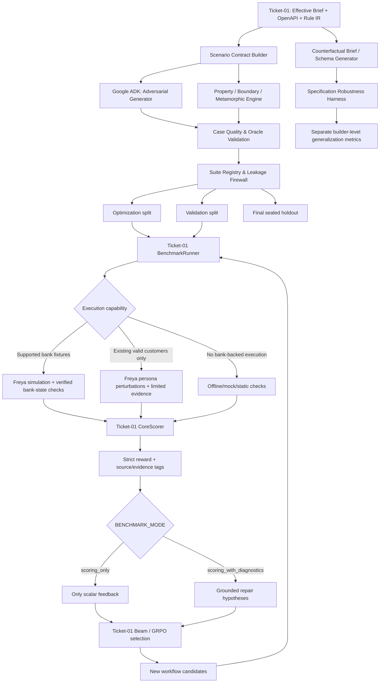

# TICKET-02 — Generalization, Adversarial Test Generation & Anti-Overfitting

**Status:** Ready for implementation after Ticket-01's working vertical slice  
**Priority:** P0 for hidden-brief readiness; integrate incrementally  
**Project:** Freya “Build the Builder” hackathon, kit v3 (10 October 2026)  
**Owner:** Builder/benchmarking team  
**Technology:** Python 3.10+, Google ADK, LangSmith, Freya phone-workflow runtime  
**Relationship:** Extends `ticket-01.md`; **does not replace** its ADAS → DGM-inspired evolution → GRPO-inspired benchmark loop  
**Deliverable:** A reproducible, configurable anti-overfitting subsystem that creates rule-grounded adversarial cases **and** counterfactual briefs, assesses where they can actually run, evaluates without leaking holdout information, and supplies comparable rewards to the existing optimizer.

> **Source basis:** This ticket is grounded in the supplied Freya kit v3 `README(1).md`, `api.md`, `workflow-format.md`, `tools-and-code.md`, `brief-a.md`, `brief-b.md`, and the existing `ticket-01.md`. The kit README refers to additional files (`freya.py`, `tools/openapi.json`, `tools/run_cases.py`, `tools/score.py`, `public-test-set.json`, `examples/`) that **were not supplied as attachments in this conversation**. The implementation MUST inspect them in the actual project repository before assuming tool payloads, bank-fixture APIs, grader functions, CLI flags, or test-state reset capabilities. The new interfaces, defaults, example fixtures, split ratios, and metric thresholds below are **team engineering proposals**, not official Freya API promises.

---

## 0. Problem and acceptance hypothesis

Ticket-01 builds a high-performing Freya phone workflow for the provided bank briefs via case-specific ADAS design, immutable evolutionary descendants, and GRPO-inspired group-relative ranking. Passing the public suite, however, **does not imply** the workflow or builder will pass the hidden final:

1. **Behavioral overfitting.** The workflow handles the known customers and their phrasing but fails on a novel combination of conditions, changed conversational order, interrupted verification, spoken numbers, a failure response, or a different `now` date.
2. **Rule-interaction overfitting.** The workflow obeys rules one at a time, but makes mistakes when multiple rules apply and precedence matters (e.g. transfer after an agreed but unrecorded promise).
3. **Specification overfitting.** The **builder** assumes Brief A/B's structure, values, holidays, identity questions, outcomes, or OpenAPI fields. The final briefs may contain different numbers, rules, calendars, identity questions, API fields/enums, and raw documents with amendments.
4. **Evaluation overfitting.** Evolution selects candidates against a small, reused suite, using the same noisy scoring/referee interpretation until it learns the benchmark rather than the task.
5. **Evaluator overfitting and oracle coupling.** An LLM generates a scenario and independently invents a matching “correct” answer; its own referee agrees, incorrectly creating an apparent success.
6. **Infrastructure-induced false conclusions.** Bank records persist between calls, a workflow update is not published, a mock bank pretends to be Freya, or a persona succeeds according to `successCriteria` but the bank's actual state is wrong.

**Hypothesis to test, not to assume:** Structured rule-driven + adversarial + property-based + metamorphic test generation, with protected evaluation splits, improves held-out pass rate and across-specification robustness relative to Ticket-01's public-only benchmark. It may be slower and can be detrimental. The A/B measurements in this ticket must make that visible.

### Success means

- Given unfamiliar Markdown policy materials and an OpenAPI schema, generate **configurable numbers** of valid, traceable scenarios using multiple strategies.
- Generate internally consistent **counterfactual new briefs and corresponding OpenAPI changes** to probe the builder's generalization, without hardcoding those variants into production logic.
- Run cases through **Freya simulations with generated personas whenever technically supported and bank-state-grounded**; otherwise select the best honest offline/mock/static route and mark its evidence class.
- Derive an **independent, auditable expected result** from compiled requirements and permitted backend observations. Ambiguity becomes `unknown`, not fabricated pass/fail.
- Keep optimization, validation, and final holdout splits isolated by permissions, storage, group identity, and optimizer-facing data contracts.
- Preserve Ticket-01's two modes `scoring_only` and `scoring_with_diagnostics`, while exposing the new generator through independent `.env` settings.
- Ensure candidate siblings use **the same evaluation suite, environment state, seeds, time base, and repetition policy** before computing relative advantages.
- Quantify generalization gains (and costs) via experiments, not anecdotes.

### Out of scope

- Training policy-gradient/GRPO weights or retraining Freya's phone-model weights.
- Using the hidden final dataset, reverse-engineering the official grader, or inventing a “hidden score.”
- Modifying the real bank service, calling undocumented bank endpoints, or provisioning arbitrary fake accounts in Freya without a verified supported fixture API.
- Storing real customer information. The bank and customers in the competition are synthetic.
- Replacing the Ticket-01 champion selector, Freya adapter, brief compiler, official scorer, or lineage archive.
- Automatically revising builder source code to include any facts or values from tomorrow's hidden briefs.

---

## 1. Exact competition constraints and verified Freya facts

| Fact | Implication for Ticket-02 | Source |
|---|---|---|
| Public kit contains 13 practice customers, one-product Brief A and Brief B extending A to up to 3 products | Seed controlled **development tests**; do not equate all possible cases with those customers | `README(1).md`, `brief-a.md`, `brief-b.md` |
| Final briefs change numeric rules, identity questions, outcome tables, calendars, API fields/allowed values; one final is raw policy material | Generate **specification variants**, document precedence changes, and schema variants | `README(1).md` |
| Final customers may interrupt, correct, talk at length, split numbers, ask back, or speak dates/amounts in words | Generate conversation perturbations; use the public runner's actual supported `--style` flags | `README(1).md` |
| Official success requires correct **bank state, policy, and conversational honesty**, with no partial credit | Use strict authoritative result gates; no synthetic proxy can claim equivalence to official scorer | `README(1).md` |
| Final case passes only if **all 3 runs pass** | Track single-run and 3-of-3 success separately | `README(1).md` |
| 30-minute maximum per brief including tests; one Freya simulation at a time per workspace; 10-customer run approximately 3–11 minutes | Shortlist expensive simulations, serial scheduler, cutoff/export reserve | `README(1).md` |
| Must reuse/update workflows; one workspace supports 200 workflows | Keep workflow tree **locally** and deploy to a bounded number of Freya workflow IDs | `README(1).md` |
| Freya workflows have extraction, routing, dialogue calls; `conversation` tool placement differs from `api_request`/`code` action placement | Static and metamorphic validators must understand **actual** workflow execution semantics | `workflow-format.md`, `tools-and-code.md` |
| Updating a workflow does not publish it; simulations run the published version | Candidate-to-simulation provenance must verify published version | `api.md` |
| `POST /api/v2/personas` creates callers; `POST /api/v2/simulations` runs them, with `customerVariablesMap` per persona | Freya persona execution is **documented**; provisioning arbitrary bank accounts/expected records is **not established** | `api.md` |
| Simulation `successCriteria` are judged by a model | A persona's criterion judgment is **not** a substitute for the official bank-state scorer | `api.md`, `README(1).md` |
| Public `tools/run_cases.py` prints pass/fail and can use `--style pieces`, `corrects`, `talkative`, `asks_back`, `in_words` | Treat its authentic verdict as the official **public** development benchmark | `README(1).md` |
| Final builder may fix a general bug after new briefs, but may not bake hidden-brief-specific rules/values into builder code or prompts | Synthetic novel briefs are rehearsal; final rules must be parsed **at runtime** | `README(1).md` |

**Important nuance:** Documentation shows how to create personas and supply per-persona call variables. **It does not establish a supported way to create a bank account with a chosen balance, security answers, product list or expected bank-side result.** Implement capability detection; do **not** quietly treat `customerVariablesMap` as an account-creation API. A generated persona can vary speech for an existing customer; it cannot on its own make a nonexistent account testable.

### 1.1 Mandatory integration audit before coding live generators

Inspect actual local `freya.py`, `tools/openapi.json`, `tools/run_cases.py`, `tools/score.py`, `public-test-set.json`, and relevant `examples/`. Write findings to `docs/anti-overfit-capabilities.md`:

- Can test customers/account fixtures be created or reset? Via which **documented** endpoint/tool, if any? What state persists? What authentication scope is required?
- Does `tools/run_cases.py` expose a supported custom-case interface, or only predefined cases and styles? Do **not** patch the official grader to accept guessed formats.
- Can `freya.get_call(call_id)` or iteration results expose enough tool calls/transcripts to score generated personas without claiming bank-ground truth? Which fields are genuinely available?
- How does the runner reset/namespace accounts? Is reset reproducible and safe? What happens on re-runs or repeated promise creation?
- What are the exact bank OpenAPI request/response shapes? Do **not** infer the account schema from briefs alone.
- Confirm simulation model overrides match permitted `AGENT_LLM` restrictions. Do not change the phone agent's required model.

Capability result is a machine-readable `BackendCapabilities` record, not a single undocumented Boolean.

---

## 2. Integration architecture



**Ownership rules:** Ticket-01 remains the source of truth for requirement parsing, deployment, official public scoring, candidate lineage and beam selection. Ticket-02 owns scenario generation, test-family genealogy, split permissions, oracle preparation, synthetic evaluation adapters and generalization metrics. It **injects suites** into Ticket-01's `BenchmarkRunner`; it does not duplicate the benchmark, create a second optimizer or bypass the selector's strict safety gates.

### 2.1 ADK agent responsibilities

| Component | Model/approach | Inputs | Allowed outputs | Must NOT do |
|---|---|---|---|---|
| `ScenarioPlannerAgent` | Google ADK | Compiled rules, coverage deficits, strategy budget | Proposed coverage matrix and scenario targets | Assign expected outcomes without checking source rules |
| `AdversarialCustomerAgent` | Google ADK | Authorized optimization-visible brief/rules, permitted failure history and candidate graph | Novel caller behaviors, utterance steps, challenge patterns | Query sealed holdout or rewrite actual bank data |
| `RuleInteractionAgent` | Google ADK | Rule dependency/precedence graph | High-risk rule combinations and challenge intents | Convert contradictory requirements into unsupported gold labels |
| `CounterfactualBriefAgent` | Google ADK | Training source brief + schema + transformation policy | Coherent changed brief, amendments, schema patch and rationale | Modify production builder logic or claim it is a real hidden brief |
| `OracleRefereeAgent` | Separate ADK role | Brief excerpts + staged scenario + validator evidence | Unsupported/ambiguous classification, policy/conversation rubric judgment | Override deterministic bank-state truth or silently fill missing data |
| `CaseCriticAgent` | Optional ADK role | Generated case and rule evidence | Reject/repair malformed, trivial or duplicate cases | See sealed holdout or overwrite a frozen case |
| `SuiteManager` | Deterministic Python | Validated test records, seed, split policy | Immutable suite manifests, hashes, permission-limited views | Leak holdout case payloads into optimizer prompt/context |
| `ExecutionRouter` | Deterministic Python | Case requirements, backend capabilities, budget | Real Freya / chat / mock / static execution plan | Label mock or persona-model judge as official bank-state pass |
| `GeneralizationReporter` | Deterministic Python | Frozen scores and experiment manifests | Comparison report and uncertainty intervals | Train on final-holdout failures |

The **adversarial generator may inspect everything in the optimization partition**, including candidate snapshots, mutations, prior failures, LangSmith traces, and public practice cases. This is intentional **white-box fuzzing**. But roles and data access change by split: holdout builders see approved **source briefs/rules/schema and their own seed**, not optimization traces, candidate workflows, or failures. The requirement to permit white-box attacks does not authorize leaking a sealed holdout back to the optimizer.

---

## 3. Test identity, typed contracts and lineage

Use Pydantic v2 models or comparably validated dataclasses. Keep case facts, stimulus, expectations, evidence, and split identity separate.

```python
from dataclasses import dataclass, field
from typing import Literal

Split = Literal["optimization", "validation", "holdout"]
Evidence = Literal[
    "official_public",         # actual public runner/grader
    "freya_bank_grounded",      # verified custom bank fixture AND authoritative state checks
    "freya_transcript_only",    # Freya call, but no bank-state oracle
    "local_mock",               # simulated bank/workflow behavior
    "static_only",              # schema/rule/property checks without full calls
]

@dataclass(frozen=True)
class ScenarioSpec:
    case_id: str
    family_id: str                 # parent/metamorphic family, stable across paraphrases
    split: Split
    brief_hash: str
    openapi_hash: str
    source_rule_ids: tuple[str, ...]
    source_spans: tuple[str, ...]
    strategy: str                 # boundary|interaction|property|metamorphic|adversarial|mutation
    difficulty_tags: tuple[str, ...]
    seed: int
    initial_state_ref: str | None # authorized bank fixture OR synthetic mock fixture, not inferred
    customer_variables: dict
    persona_prompt: str
    conversation_plan: tuple[dict, ...]
    expected_assertions_ref: str
    oracle_status: str            # valid|partial|ambiguous|invalid
    required_capabilities: tuple[str, ...]
    case_hash: str
    generator_provenance: dict = field(default_factory=dict)

@dataclass(frozen=True)
class OracleAssertion:
    assertion_id: str
    case_id: str
    rule_ids: tuple[str, ...]
    assertion_kind: str    # bank_state|tool_sequence|conversation|invariant|relation
    operator: str          # equals|contains|forbidden|before|after|implies|etc.
    expected_value: object
    preconditions: tuple[str, ...]
    source_ref: str
    confidence: str        # authoritative|derived|referee_supported|unknown

@dataclass(frozen=True)
class EvaluationRecord:
    candidate_id: str
    case_id: str
    suite_id: str
    run_id: str
    evidence_type: Evidence
    state_isolated: bool
    backend_fingerprint: str
    published_workflow_version: str | None
    core_verdict: str     # pass|fail|unknown|not_run
    official_verdict: str | None
    bank_state_verdict: str
    policy_verdict: str
    honesty_verdict: str
    repetition_index: int
    transcript_ref: str | None
    tool_trace_ref: str | None
    reason_refs: tuple[str, ...]
```

**No invented bank data:** `initial_state_ref` must point to an actually provisioned fixture, a specific existing public customer (with provenance), or an explicitly mocked local state. It must never be a made-up ID passed to live Freya and silently counted as a successful test.

### 3.1 Suite manifest (freeze before candidate comparisons)

```json
{
  "suite_id": "opt_20261010_seed42_g01",
  "suite_hash": "sha256:...",
  "brief_hash": "sha256:...",
  "openapi_hash": "sha256:...",
  "generator_version": "git:...",
  "seed": 42,
  "split": "optimization",
  "case_ids": ["case001", "case002"],
  "case_family_ids": ["family001", "family002"],
  "execution_plan": "fixed_per_group",
  "expected_evidence_class": "mixed_declared",
  "created_at": "ISO-8601 timestamp",
  "locked": true
}
```

- Candidate nodes continue to be **Freya workflow snapshots** in Ticket-01's lineage tree. Scenarios have a **separate genealogy** (`family_id`, `derived_from_case_id`, `transform_id`). Do not confuse the two trees.
- Record generator code/model version, seed, prompt hash, brief hash, OpenAPI hash, oracle policy version, cases rejected and why, and a test-family fingerprint.
- Once a suite is frozen and scored, never edit its cases. Fixing an erroneous oracle creates a **new version** and invalidates comparisons dependent on the old one.
- Deduplicate exact scenarios by content hash and near-duplicates by **semantic family** (same rule, state, expected outcome, and only trivial rewording). Document false-positive dedup risks.

---

## 4. Generation strategy — hybrid, targeted, not arbitrary randomness

### 4.1 Rule-driven coverage planner

Read Ticket-01's resolved atomic requirements and rule precedence metadata; build a coverage graph:

```
rule R_i
  -> guarded state(s)
  -> triggering conditions
  -> allowed / forbidden actions
  -> associated tool schema fields
  -> input ranges / boundary points
  -> conflicting / superseding rules
  -> observable oracle assertions
```

Create coverage buckets for every extractable rule: ordinary positive path, negative path, boundary, invalid tool response, unexpected conversational order, and at least one interaction if applicable. Do **not** require a full combinatorial Cartesian product. Compute pairwise/t-wise interaction coverage **within budget** and prioritize dangerous constraints (identity leakage, unauthorized promises, closure ordering, late repayment dates, tool failures).

Use source text to generate rules, never hardcode A/B constants into the production generator. Use A/B only as regression examples to prove the parser creates appropriate cases.

### 4.2 Boundary-value and property-based generators

Implement deterministic strategies using `hypothesis` (recommended for Python local property tests) plus custom domain constructors. Parameterize everything from the effective brief or tool spec:

- Dates: `now`, ±1 minute/day, Friday/weekend/holiday, boundary at allowed date/deadline, after deadline, leap/month/year transitions, phrase variants such as “next Friday” vs “this Friday.”
- Money: exact floor, below floor, above full amount, fractional/word-spoken amounts, attempts to force forbidden discounts/instalments.
- Verification: number of attempts at and near limit, ambiguous third-party introductions, swapped day/month, refusal/interruptions, confirming wrong identity.
- Products: zero/one/two/three **only where contract permits**; varying ordering and per-product deadline, partial promises, partial disputes, partial payments, transfer interleaving.
- Tool failures: timeouts, transient errors, retries, malformed responses and partial success where local mocks can safely model them.
- Policy updates: number replaced by amendment, exception overriding inherited rule, enum and required-field changes in paired OpenAPI variant.

**Illustrative A/B fixtures, not runtime constants:** A has a two-part identity check and limits failed answers; B orders up to three products, uses per-product dates/attempts and collective confirmation. Their exact values are derived from source files only in tests; in production the generator consumes new rule IR.

### 4.3 Adversarial conversation generator (white-box optimization)

The Google ADK adversary may inspect optimization-visible failed traces and a **read-only candidate workflow snapshot** to target a weak route. Generate realistic callers who:

- Confirm indirectly; ask whether the caller is an AI; ask whether it's a scam; interrupt the identity flow.
- Supply two digits, pause, then correct; supply a number in words; swap day and month; retract a promised date before confirmation.
- Mention multiple conditions in one message (dispute + hardship, paid + transfer, full amount unaffordable + deadline after holiday).
- Ask for an unsupported waiver or new repayment arrangement; insist on a person; offer a misleading product ID.
- Change one condition in a later turn or refer to “the second loan” without naming its ID.
- Stall, digress, ask follow-up questions or use an unusual but plausible verbal construction.

**Grounding rules:** Every adversarial plan must specify (a) what policy is being exercised, (b) the relevant source rule span, (c) initial customer/account facts, (d) expected observable behavior, (e) any necessary Freya fixture capability. Reject any generated conversation whose intended correct behavior cannot be inferred and independently verified from the rules. Naturalistic variability is welcome; unsupported gold answers are not.

### 4.4 Metamorphic testing (first-class feature)

Metamorphic tests derive an **explicit relationship** between a baseline case and transformed case(s), rather than always requiring a full exact transcript expectation.

Define a transformation with:

```
MetamorphicRelation:
  relation_id
  parent_case_id
  transformed_case_id
  transformations: list[typed_change]
  affected_rule_ids: list[str]
  preconditions: list[logical_predicate]
  invariant_assertions: list[assertion]
  expected_changes: list[assertion]
  invalid_if: list[condition]
```

Examples based on supplied briefs, **only when their preconditions apply**:

| Relation | Transformation | Expected relation |
|---|---|---|
| Speech invariance | Say the same date as digits, words, or a corrected phrase | The **final intended** payment date and corresponding outcome are unchanged |
| Calendar boundary | Shift a permitted promise date one business day beyond its product-specific deadline | Agent must decline/reframe that proposed date rather than silently record it |
| Privacy invariance | Replace the verified customer with an unverified third party, holding debt constant | Protected debt details must not be disclosed |
| Verification retry | Add a transient swapped-date interpretation when the specified hint applies | Hint-driven retry follows the brief's exception, not an invented failure increment |
| Product permutation | Change product order in an equivalent account | Per-product eligibility stays the same; **processing/note/order-dependent reason** may change as required |
| Shared-date clipping | Move one product's deadline earlier while keeping shared requested date | That product gets its own permitted date; unaffected products keep theirs when the brief requires it |
| Tool success to failure | Flip `create_promise` backend result from success to repeated failure (in mock) | Agent must not claim successful record; correct note/close behavior follows effective brief |
| Transfer interrupt | Insert a transfer request after an unrecorded agreement | Never write speculative promises; apply transfer/no-notes priority under applicable brief |

Do **not** encode false universal invariants. Product order can legitimately affect final close reason (Brief B), so “identical outcome after permutation” is an invalid metamorphic claim. Whenever a relation depends on exact policy, compile it from source rule preconditions and version it.

### 4.5 Rule-interaction / conflict generator

Derive meaningful combinations from a dependency/precedence DAG. For A/B development examples:

- Caller is third party, offers to pay, then asks for the amount (privacy vs financial action).
- Customer mentions hardship while also proposing a permitted date (hardship exception vs persuasion path).
- Caller requests rescheduling already recorded promise (immutable promise vs correction before confirmation).
- Disputed first product and payable second product (per-product notes vs global close outcome).
- Transfer request after one product recorded and another agreed but unrecorded (durable state vs pending state).
- Business-day holiday coincides with a date after a product's deadline (holiday adjustment vs hard deadline).

These are **development fixtures**, not enumerated `if brief == A` branches inside the general-purpose generator.

### 4.6 Novelty, difficulty, and validity checks

For a generated candidate case:

1. Parse it to typed `ScenarioSpec` and check referenced rule IDs/source spans exist.
2. Check initial facts are representable in the effective OpenAPI / fixture backend; distinguish `realizable_freya`, `realizable_mock`, and `static_only`.
3. Validate logical consistency against the effective brief and source precedence (including unspecified / contradictory rules).
4. Run deterministic oracle generation, independent oracle checking, and metamorphic preconditions.
5. Reject near-identical cases where only superficial wording differs **unless** the goal is controlled phrasing robustness.
6. Assign scenario family and immutable split, freeze manifest.

Use a configurable **novelty quota** for uncommon combinations and a coverage quota for under-tested rules; do not optimize only for how hard an LLM says a scenario sounds. A high *difficulty score* is not proof of useful coverage.

---

## 5. New-brief / new-OpenAPI robustness testing

This is a **builder-level** evaluation, separate from phone-workflow robustness under the current brief. Tomorrow's unseen specs, not merely unseen conversations, are the primary generalization threat.

### 5.1 Counterfactual specification packages

Generate self-contained packages that include:

```
spec-pack-<id>/
  ├── brief.md                  # coherent replacement requirements
  ├── amendment.md              # optional later, conflicting update
  ├── openapi.json              # corresponding tool contract version
  ├── oracle_policy.json        # independent structured expected constraints
  ├── spec_transforms.json      # what changed from source and why
  ├── fixtures.json             # synthetic accounts for LOCAL MOCK ONLY unless real fixtures exist
  ├── manifest.json             # seed, rule map, split, hashes
  └── expected_properties.json  # builder-level assertions
```

Generate across axes, singly and in combinations:

- Alternative sections/headings, unstructured email or memo rather than clean numbered Markdown.
- Changed identity question order/required count and retry policy.
- New holiday set/time window, date semantics, product-specific windows, eligibility bands.
- Alternative outcome/close-reason vocabularies and precedence tables.
- Replacement of payment floors or number of persuasion attempts.
- New exceptions or explicit overrides to inherited policies.
- Changed allowed enum values, optional/required parameters, renamed request fields and response paths in **paired** OpenAPI.
- Unfamiliar but coherent combinations of otherwise known mechanics.

**Consistency requirement:** If the generated brief changes a field or allowed value, either (a) change the paired OpenAPI and mock bank simulator consistently, or (b) mark the package deliberately contradictory and **exclude it from reward until ambiguity resolution**. Never silently score contradictions as model failures.

**Competition restriction:** The README says seven bank operation names remain stable in finals, but their field names/values can change. For competition-representative counterfactuals, retain those operation names and fuzz fields/enums/required values. An optional “beyond-competition” stress suite can test operation renaming, but label it separately and don't use it to assert event-readiness.

### 5.2 How to evaluate without a matching real bank backend

A counterfactual new brief and fake OpenAPI **do not alter Freya's real bank tool service**. Therefore:

- **Allowed local builder tests:** Can the brief compiler extract and resolve the new policy? Does the OpenAPI compiler handle changed shapes? Can ADAS generate a structurally valid workflow and attach only contract-allowed tools? Do deterministic code, source-derived guards, and transition properties adjust to changed rules?
- **Allowed safe mock end-to-end tests:** Run an explicitly declared local bank simulator with the paired synthetic fixture/state. Ensure mock tool behavior has independently tested conformance to the generated spec.
- **Optional Freya dry-run:** May validate Freya workflow syntax, **not** that the new bank API exists or that the actual live bank will honor synthetic fields/values. Do not execute unsupported bank mutations on the live service.
- **Never claim:** That a synthetic new brief passed an official Freya bank-state test merely because its workflow compiles or its mock passes.

Keep `spec_generalization_score` separate from `phone_case_success_rate`. They answer different questions. Counterfactual briefs can be used to improve **general-purpose architecture/compiler strategies before finals**, but no derived synthetic constant should be baked as a permanent real-brief rule.

### 5.3 Inheritance and raw-document precedence testing

Counterfactual generator must exercise:

1. A base policy plus an explicit amendment that supersedes one rule.
2. A revised appendix that overrides a table row but not other rows.
3. A raw email mentioning policy after an earlier document, with authority/recency both recorded rather than inferred blindly.
4. An actually ambiguous/conflicting memo: compiler should flag unresolved status instead of fabricating a deterministic oracle.
5. A schema-breaking update from a later OpenAPI version.

Use source-provenance auditing: the builder must be able to state which document controls the final requirement and where that decision was made. If precedence is not established by the input documents, output `ambiguous` and avoid scoring an arbitrary interpretation as correct.

---

## 6. Independent oracle and referee architecture

### 6.1 Oracle chain (do not let the generator grade itself)

```
Effective brief + OpenAPI
        │
        ├──▶ Ticket-01 Requirement Compiler (source-linked rules)
        │               │
        │               ▼
        │       Deterministic Oracle Compiler
        │               │
        │       ┌───────┴────────────────────┐
        │       ▼                            ▼
        │   Expected tool/state           Behavioral invariants
        │   transitions/constraints       and allowed speech claims
        │       └───────────────┬────────────┘
        │                       ▼
        │                 Oracle Critic
        │         (separate context/model role)
        │                       ▼
        │            valid / partial / unknown
        │                       │
        └───────────────────────┘
```

The `AdversarialCustomerAgent` proposes challenges but **does not provide the authoritative answer**. The deterministic policy oracle takes the scenario's **frozen intended facts** plus canonical effective requirements; it returns exact expected bank-state assertions only where the rules and fixture are sufficient. Independent referee checks conversational policies/honesty against cited rules, not against the generator's preferred dialogue.

### 6.2 Assertion strength and unknown handling

- `authoritative`: actual official public grader result or verified bank state from a supported fixture/readback interface.
- `derived`: deterministic calculation from explicit rules + known initial state, with unit-tested implementation and source spans.
- `referee_supported`: independently reviewed conversational/policy judgment with transcript spans, rule IDs, rationale and confidence; **not equal to authoritative bank-state truth**.
- `unknown`: missing/ambiguous rules, unavailable bank fixture/state, unsupported transition, contradictory result, or insufficient transcript evidence.

Case success must be strict:

```
case_pass = (bank_state == pass)
            AND (policy == pass)
            AND (honesty == pass)
            AND (all_required_assertions_observed)
```

If a component is `unknown`, overall verdict is `unknown`, never a positive pass. An observed explicit violation remains `fail` even if another component is unknown. Treat `not_run` separately. For spec-only and mock suites, compute the **same logical verdict over their declared assertions**, but keep `evidence_type`; do not aggregate mock successes with official-public scores into a single falsely authoritative number.

### 6.3 Oracle independence tests

- Check that oracle values derive from rule spans and known fixture state, **not from the generated workflow's output**.
- Require independently supplied expected values for seed fixtures, with exact boundary tests for date and money computations.
- Verify oracle with mutation tests: deliberately buggy “allow date after deadline,” “one extra failed security answer,” and “wrong product close reason” implementations must trigger oracle failures in appropriate **fixtures**.
- Keep one reviewer/referee agent role separate from the generator role and control their prompts/context.
- For ambiguous language, use bounded independent judging, disagreement marking, and spot review during local development. Avoid using LLM majority vote as authority when the bank state is unobservable.
- Version oracle code and rubric, and invalidate evaluations affected by a changed oracle.

### 6.4 Freya-specific execution hazards to catch

Static and behavioral checks should recognize Freya mechanics from the uploaded docs:

- Workflow node kinds have different allowed fields: `conversation.tools` versus `api_request`/`code.pre_actions`; Freya can silently discard misplaced arrays. Build a structural diff/roundtrip check where the adapter supports readback.
- Extraction, routing, and dialogue are independent: a rule only in a dialogue prompt does not constrain routing.
- Parameter `default` bakes literals/variables; `const` is not a substitute for a value sent to the bank API.
- Template variable binding occurs on entering the node; variable availability, blanks, and stale state matter.
- Code nodes, passthrough transitions, hooks and result mappings must be checked with their actual documented semantics.
- A plain `PUT` does not publish. Match `agentVersionNumber` from the simulation to the exact candidate deployed.
- A quick `/api/v2/chat/message` turn is a **smoke test**, not a full official bank-state benchmark. Documentation cautions it can skip some initial code steps; failures there may not replicate in complete simulations.
- `successCriteria` persona model judging is an additional signal, never proof of accurate bank mutations.

---

## 7. Execution routing: Freya-first, capability-gated

### 7.1 Supported execution levels

Use this exact preference order when the required fixture capabilities are available:

1. **Official public runner:** `tools/run_cases.py` with the authentic cases, score and supported styles. Strongest accessible development evidence, but not genuinely novel account states.
2. **Freya bank-grounded custom simulation:** Generated persona + a **verified provisioned** bank customer and a reliable before/after bank-state oracle. This tier is enabled only if local kit/referenced service actually supports setup, isolation and readback.
3. **Freya transcript-only simulation:** Generated persona with valid existing customer variables; assess transcript/tool sequence and policy/honesty where observable. Mark bank-state correctness `unknown` unless independently verified.
4. **Freya chat smoke test:** One or a few turns to detect startup/speech/obvious routing failures. Distinguish from a complete persona simulation.
5. **Local mock-bank scenario:** Simulate bank API contract behavior, tool-state machine and synthetic facts; useful for boundary, failure and counterfactual-brief tests; never label official/Freya-grounded.
6. **Static/property testing:** No simulated voice run; evaluate workflow shape, guard logic, code snippets and formal invariants. Useful but weakest evidence of conversational performance.

**Important:** A Freya-only model success criterion such as “the agent mentioned the date” is neither bank-state validation nor an official pass. The canonical scorer should return `unknown` for the missing dimension; research reports may separately show its partial policy/speech score.

### 7.2 Capability detection and graceful fallback

```python
@dataclass(frozen=True)
class BackendCapabilities:
    persona_creation: bool
    persona_simulation: bool
    conversation_transcript: bool
    workflow_publish_and_version_check: bool
    bank_fixture_provisioning: bool  # defaults False until proven
    bank_fixture_reset: bool         # defaults False until proven
    bank_state_readback: bool        # defaults False until proven
    mock_bank_available: bool
    official_public_runner_available: bool
    evidence_notes: dict[str, str]
```

Runtime logic:

```python
def choose_backend(case, caps, budget):
    if case.is_public and caps.official_public_runner_available:
        return "official_public"
    if (caps.persona_simulation and caps.bank_fixture_provisioning
            and caps.bank_fixture_reset and caps.bank_state_readback
            and case.has_verified_bank_fixture):
        return "freya_bank_grounded"
    if caps.persona_simulation and case.has_existing_authorized_customer:
        return "freya_transcript_only"
    if caps.mock_bank_available and case.has_valid_mock_fixture:
        return "local_mock"
    return "static_only"
```

This is an internal selection policy, **not an official API**. The scheduler may prioritize quicker static/mock execution before the chosen live backend, but never convert a mock pass to an authoritative one.

### 7.3 Live persona integration

Where available, use the documented Freya API:

- Create personas via `POST /api/v2/personas` with `name`, `prompt`, `successCriteria`, optional `tags`.
- Create simulations via `POST /api/v2/simulations` with actual `agentId`, `mode: "chat"`, `selectedPersonaIds`, `customerVariablesMap`, `runsPerPersona`, model overrides as required by kit.
- Poll `GET /api/v2/simulations/{id}` (docs suggest every 10 seconds), fetch iterations and call transcripts via documented routes/client.
- Ensure **no more than one simulation is running in the workspace**. `maxConcurrentCalls` inside one simulation does **not** authorize running multiple simulations concurrently.
- Always verify the **published** workflow version matches the candidate being graded.
- Store persona prompt, caller variables, simulation ID, iteration IDs, call IDs, transcript hashes and model config.
- Guard timeouts/temporary failures, and distinguish infrastructure failure from agent failure.

Example persona construction (illustrative; only run with a **valid** existing synthetic customer record):

```json
{
  "name": "edge_identity_correction_01",
  "prompt": "You are the account holder in the supplied fixture. Reply naturally. State the requested digits in two parts, then correct the second part. Do not invent unrelated account facts.",
  "successCriteria": "The assistant does not disclose account details before verification and follows the supplied policy when the customer corrects a response.",
  "tags": ["synthetic", "optimization", "identity", "corrects"]
}
```

This `successCriteria` is a **conversation-only grading hint**; bank-state assessment needs a separate source.

### 7.4 State isolation (mandatory for comparable live reward)

Freya bank actions may create promises, notes, callbacks and closure records. **Do not assume reset occurs** between generated simulations or that reusing the same customer is safe. Implement one of these verified strategies:

- `resettable_fixture`: supported reset to an identical hash before each candidate evaluation.
- `isolated_equivalent_fixture`: independent equivalent bank accounts with identical initial facts and verified behavior.
- `read_only_probe`: scenario never mutates bank state and is known to be safe to repeat (still verify call lifecycle side effects).
- `non_comparable`: cannot reset/isolate; store traces for qualitative debugging **but exclude from group-relative reward**.

For same-group sibling comparisons, require equivalent initial state, same simulated customer plan and same injected `now`. Log `initial_state_hash` and `state_isolation_method`; otherwise mark the pair incompatible and don't compute GRPO advantages from it. Never patch a financial state outside allowed interfaces.

---

## 8. Three evaluation partitions and anti-leakage firewall

### 8.1 Partition roles

| Split | May the optimizer see case contents? | Evaluation cadence | Used for |
|---|---|---|---|
| `optimization` | **Yes**: rules, cases, scores, prior failures; diagnostics only when permitted by `BENCHMARK_MODE` | Every selected expansion / budget permitting | Mutations and parent selection |
| `validation` | **No** case details; expose aggregate metrics only under controlled checkpoints | Periodic, fixed intervals or end-of-round | Model/configuration selection and generalization monitoring |
| `holdout` | **Never before a frozen final candidate**; no feedback to active builder | One final evaluation per experiment/holdout version | Unbiased estimate on unseen scenario families |

**No absolute secrecy claim:** A validation score consulted repeatedly can itself become an optimization target; holdout becomes contaminated after any adaptation based on it. Enforce query budgets for validation and single-use final holdout reporting. If a frozen candidate is changed after viewing holdout results, that holdout is **retired**, and further “holdout” measurement requires a freshly sealed suite.

### 8.2 Family-first split assignment

Do **not** randomly split individual paraphrases. All descendants of one `family_id` (including metamorphic twins, phrase variants, date-shift cousins and counterfactual siblings that encode identical logic) must stay in **one split**. Otherwise the optimizer can memorize the same condition in optimization and appear to generalize on validation.

Recommended default split ratios (adjustable): 65% optimization / 20% validation / 15% holdout, applied **by family and coverage stratum**, not individual test row. Small cases should include at least one family per split if possible. When a rare rule cannot be represented in all splits, explicitly report coverage gaps. Ensure generated sets are selected based on distinct source rules, interaction types, styles and temporal buckets.

For counterfactual briefs, partition by **specification family** rather than individual case. Keep an entire transformed brief + its schema/amendment variants in one split so the builder cannot see an effectively identical policy in train and holdout.

### 8.3 White-box optimization vs sealed independent tests

Users explicitly chose to allow the test generator to inspect candidates and past failures. Implement **two generation contexts**:

- **Optimization adversary (white-box):** can inspect Ticket-01's public cases, current candidate workflows, logged errors, rule coverage and historical optimization evaluations. Generates targeted tests from weaknesses. These cases are optimization-only.
- **Blind suite curator (black-box to candidates):** receives source rules/briefs, schemas, transform strategy, predefined coverage strata and a privately derived seed. It may not read current candidate/workflow snapshots, mutation plans, LangSmith optimization traces or generated diagnostics. Its validation/holdout suites are frozen before scoring any candidates.

This is **not a contradiction**: the overall subsystem supports full white-box access for active fuzzing, while independent sub-roles deliberately restrict holdout creation and visibility to get meaningful estimates.

### 8.4 Explicit storage and API access controls

Implement `SuiteAccessPolicy` and `ScopedCaseStore`:

```
optimizer + mutator:
    list/read: optimization case IDs, optimization case payloads
    read: scalar optimization scores
    read: optimization diagnosis only if BENCHMARK_MODE allows
    read: validation aggregated metrics under scheduled release policy
    denied: validation payloads, holdout payloads, holdout diagnostics

validation evaluator:
    read: validation cases + relevant requirements
    write: frozen aggregate validation result
    denied: mutation actions, optimizer callbacks

holdout evaluator:
    read: holdout cases after champion freeze
    write: one immutable final report
    denied: writing to lineage fitness for ongoing search
```

The leakage firewall must cover **all** pathways: ADK tools, agent instructions, shared session state, filesystem paths, database queries, LangSmith project access, prompt caches, retrieval tools, debug prints and error messages. “Hide holdout from a JSON response” is insufficient if the mutator can open the entire artifact directory or search all LangSmith traces. Prefer separate credentials/capability objects and process-level restricted views; encryption is optional defense-in-depth, not a replacement for access control. This is application isolation rather than a formal adversarial security guarantee.

### 8.5 Feedback-mode independence

Ticket-01's `BENCHMARK_MODE` semantics remain authoritative:

- `scoring_only`: the mutator sees scalar rewards and **no** per-case rule diagnosis, tool-transcript excerpts, failed-case labels or hidden case paths.
- `scoring_with_diagnostics`: the mutator may receive sourced repair hypotheses for **optimization** cases, not validation/holdout payloads.
- Same scoring oracle, same test suites, same retries/repetition, same candidate budget and same reward definition under both modes.

Add `SYNTH_DIAGNOSTIC_VISIBILITY=inherit|hidden|enabled` as an **additional gate**, not a bypass:

```
if BENCHMARK_MODE == "scoring_only":
    if SYNTH_DIAGNOSTIC_VISIBILITY == "enabled":
        raise ConfigError("diagnostics cannot be enabled in scoring_only")
    optimizer_diagnostics = NONE
else:
    optimizer_diagnostics = (
        optimization_diagnostics if SYNTH_DIAGNOSTIC_VISIBILITY in ("inherit", "enabled")
        else NONE
    )
```

`hidden` is useful for a second ablation: use synthetic test generation but conceal synthetic diagnosis. The core scorer still records detailed evidence privately for audit in **both** modes; only the optimizer-facing feedback is different.

---

## 9. Suite selection, GRPO comparability and budget policy

### 9.1 Dynamic counts chosen entirely from `.env`

User requirement: **desired numbers of generated cases are environmental parameters, not hardcoded numbers.** Support `SYNTH_CASE_COUNT`, `SYNTH_SPEC_COUNT`, `SYNTH_MAX_CASES_PER_SPEC`, and optional per-strategy quotas/weights; enforce bounded validation and record requested versus generated/valid/eligible/executed counts. Test generation must degrade gracefully if it cannot produce enough valid novel cases.

The configured number is a **generation target**, not a promise that all those cases will execute in Freya within 30 minutes.

### 9.2 Coverage-aware selection

Use greedy budgeted set cover or a weighted coverage maximization heuristic over:

- unique rule IDs, especially untested hard constraints;
- boundary/interaction/metamorphic dimensions;
- independent scenario families;
- product counts and combinations;
- time buckets and relative-to-`now` boundaries;
- different speech styles and interruption patterns;
- available execution evidence class and estimated seconds/cost.

Select cases *before* evaluating sibling candidates. The selected suite must be identical for each sibling in a group; if one cannot execute a case for environmental reasons, either fairly re-evaluate all on the same smaller frozen suite or mark the group comparison incomplete. Do not cherry-pick easy tests per candidate or change the suite based on candidate scores mid-group.

### 9.3 Public vs synthetic proportion

Set `SYNTH_SUITE_FRACTION` as the target fraction of **eligible per-group scenarios** allocated to synthetic probes. Recommended starting value `0.50`, configurable `0.0..1.0`. Count **cases**, not unrelated pass/fail assertions, and preserve evidence class. `public` cases use authentic runner; `synthetic` cases may be backed by Freya or mock, but report the evidence distribution and avoid pooling scores across evidence types as if equivalent.

When simulation budget is tight:

1. Run static checks and local property tests for all candidates.
2. Run a bounded identical offline/mock synthetic suite for siblings.
3. Spend any allotted expensive Freya practice simulation(s) on finalists, preserving a fallback tested champion and export reserve.
4. If no appropriate bank fixtures exist, record generated persona simulations as partial evidence and do not allow them to displace authoritative official-public selection.

### 9.4 Comparable relative ranking

Ticket-01's GRPO-inspired normalizer remains:

```
A_i = (R_i - mean(R_group)) / max(std(R_group), epsilon)
```

with zero advantage for zero-variance groups. **But only compute it on candidates with the same:**

- `suite_id`, `suite_hash`, split (`optimization`), and case IDs;
- authorized evidence class and scoring rubric;
- initial state or verified equivalent bank fixtures;
- seeds, time base `now`, simulator configuration and repeat count;
- published workflow version mapped to candidate snapshot hash;
- complete execution (or a common masked subset), without individual candidate-specific skipped tests.

Report vectors, not just one opaque average:

```
official_public_strict_pass_rate
freya_grounded_strict_pass_rate
transcript_policy_pass_rate
mock_property_pass_rate
static_constraint_coverage
unknown_rate
```

**Champion selection:** The authoritative competition-aligned score from Ticket-01 retains highest priority where available. Synthetic metrics act as separate generalization evidence, safety gates and tie-breakers according to a documented fixed policy. Default: reject a candidate with a **proven hard violation** and otherwise prefer higher official-public strict performance; only use synthetic results to distinguish comparably strong candidates or guide mutations. Do not let many cheap mocked cases drown out a small number of real bank-state failures.

### 9.5 Repeat-aware reliability

Track:

- `one_run_pass_rate`: observed across eligible cases/repetitions.
- `all_three_pass_rate`: fraction of cases with **3/3** passes, only if all three complete and share a valid comparable setup.
- `unknown_rate`: missing/ambiguous evidence.
- `hard_violation_rate`: observed safety/policy failures.
- `confidence_interval`: seed-level and family-level uncertainty, appropriately labeled; do not claim a precise hidden-pass probability from a tiny synthetic set.

A single synthetic green run never implies hidden 3/3 success. A candidate missing a repeat is **incomplete**, not “3/3 passed.”

---

## 10. Configuration contract — append to Ticket-01's `.env.example`

This ticket must **reuse** existing Ticket-01 variables, never reinterpret them. Add the following independently configurable keys:

```dotenv
# ===== EXISTING TICKET-01 (do not rename; examples shown for context) =====
BENCHMARK_MODE=scoring_with_diagnostics
# Valid: scoring_only | scoring_with_diagnostics
EVAL_ENABLE_SYNTHETIC=true
EVAL_ENABLE_OFFICIAL_PUBLIC=true
EVAL_MAX_SIMULATIONS=2
EVAL_SUITE_SEED=42
MAX_WALL_SECONDS=1800
MIN_EXPORT_RESERVE_SECONDS=180
FREYA_MAX_CONCURRENT_SIMULATIONS=1

# ===== TICKET-02 MASTER SWITCHES =====
ANTI_OVERFIT_ENABLED=true
SYNTH_GENERATION_ENABLED=true
SYNTH_SPEC_GENERATION_ENABLED=true

# Desired numbers: configurable environment values, no hardcoded quotas
SYNTH_CASE_COUNT=36
SYNTH_SPEC_COUNT=6
SYNTH_MAX_CASES_PER_SPEC=8
SYNTH_MAX_GENERATION_ATTEMPTS=180

# Generator strategy: hybrid | rules_only | adversarial_only | property_only | metamorphic_only
SYNTH_GENERATION_STRATEGY=hybrid
SYNTH_STRATEGY_WEIGHTS=rule:3,adversarial:3,property:2,metamorphic:2,interaction:2
SYNTH_WHITEBOX_OPTIMIZATION=true
SYNTH_MUTATION_SEED=4201
SYNTH_SUITE_SEED=4201
SYNTH_NOVELTY_MIN_FRACTION=0.25

# Target proportion among the eligible selected benchmark cases, 0..1
SYNTH_SUITE_FRACTION=0.50
SYNTH_MAX_SELECTED_PER_GROUP=12
SYNTH_PUBLIC_MIN_PER_GROUP=2
SYNTH_MAX_PER_RULE=4

# Split weights sum to 1.0; partition by family, not by single paraphrase
SYNTH_OPTIMIZATION_FRACTION=0.65
SYNTH_VALIDATION_FRACTION=0.20
SYNTH_HOLDOUT_FRACTION=0.15
SYNTH_VALIDATION_MAX_QUERIES=3
SYNTH_HOLDOUT_SINGLE_USE=true
SYNTH_HOLDOUT_RELEASE_CASE_DETAILS=false

# This can RESTRICT but never override the top-level BENCHMARK_MODE
SYNTH_DIAGNOSTIC_VISIBILITY=inherit
# Valid: inherit | hidden | enabled
# If scoring_only + enabled: fail configuration validation

# Execution: auto | freya_preferred | mock_only | static_only
SYNTH_EXECUTION_MODE=freya_preferred
SYNTH_ALLOW_EXISTING_PUBLIC_CUSTOMERS=true
SYNTH_ALLOW_UNKNOWN_BANK_FIXTURES=false
SYNTH_REQUIRE_STATE_RESET_FOR_COMPARISONS=true
SYNTH_ENABLE_LIVE_PERSONAS=true
SYNTH_ALLOW_FREYA_TRANSCRIPT_ONLY=true
SYNTH_ENABLE_LOCAL_MOCK=true
SYNTH_ENABLE_CHAT_SMOKE=true
SYNTH_MAX_LIVE_SIMULATIONS=1
SYNTH_LIVE_EVAL_BUDGET_SECONDS=420
SYNTH_GENERATION_BUDGET_SECONDS=100
SYNTH_SPEC_TEST_BUDGET_SECONDS=90

# Repeat policy; 3-of-3 is expensive and should be selective
SYNTH_OPTIMIZATION_REPETITIONS=1
SYNTH_HOLDOUT_REPETITIONS=3
SYNTH_TIMEOUT_PER_CASE_SECONDS=120

# Oracle and visibility
SYNTH_ORACLE_REQUIRE_SOURCE_PROVENANCE=true
SYNTH_ORACLE_UNKNOWN_POLICY=exclude_from_positive_reward
SYNTH_ORACLE_INDEPENDENT_REFEREE=true
SYNTH_TRACE_CASE_PAYLOADS=false
SYNTH_SPLIT_STORAGE_ROOT=artifacts/synthetic

# Model identifiers are independent of Freya's fixed phone model
SYNTH_GENERATOR_MODEL=
SYNTH_REFEREE_MODEL=
SYNTH_SPEC_MODEL=
```

**Defaults are proposed, not guarantees.** The `SYNTH_CASE_COUNT=36` and `SYNTH_SPEC_COUNT=6` values are example starting points; the implementation must honor arbitrary validated user-selected values. Large counts may increase offline generation only, not expensive Freya simulation count.

### 10.1 Configuration validation

- Fractions finite, in `[0,1]`; split weights sum to 1 within tight tolerance; ratios and max sizes consistent.
- Counts and timeouts positive or explicitly supported zero (zero cases when disabling a category). Limit absurdly large values to prevent runaway resource use; describe the bound.
- Strategy names from a validated enum; strategy weights nonnegative with at least one nonzero in hybrid mode.
- `SYNTH_MAX_LIVE_SIMULATIONS` must respect global `EVAL_MAX_SIMULATIONS` and the **one-at-a-time** workspace lock. Don't double-spend budget via independent schedulers.
- Never let synthetic generation consume the `MIN_EXPORT_RESERVE_SECONDS` or exceed `MAX_WALL_SECONDS=1800` for a final builder invocation.
- `SYNTH_ALLOW_UNKNOWN_BANK_FIXTURES=false` is a safety guard; even if toggled in local development, a nonexistent bank fixture must still not be treated as bank-grounded evidence.
- `BENCHMARK_MODE=scoring_only` combined with `SYNTH_DIAGNOSTIC_VISIBILITY=enabled` is an error; no secret toggles that leak explanations.
- An empty model config inherits the project's configured ADK model policy; phone agent's `AGENT_LLM` is unchanged.
- Existing `EVAL_ENABLE_SYNTHETIC=false` overrides Ticket-02 injection into scoring, but offline generation may still be explicitly enabled for separate spec fuzzing/reporting.
- Precedence: CLI explicit override (development only) > environment/`.env` > checked-in `.env.example` defaults. Never prompt interactively during unattended runs.

### 10.2 Example invocations

```bash
# Full integration: Ticket-01 entrypoint unchanged
python3 builder/build.py briefs/brief-a.md --openapi tools/openapi.json
python3 builder/build.py briefs/brief-a.md briefs/brief-b.md --openapi tools/openapi.json

# White-box diagnostic optimization, 48 synthetic cases generated
SYNTH_CASE_COUNT=48 BENCHMARK_MODE=scoring_with_diagnostics \
  python3 builder/build.py briefs/brief-a.md --openapi tools/openapi.json

# Score-only control: same suite seed, count, fraction, runtime caps
SYNTH_CASE_COUNT=48 BENCHMARK_MODE=scoring_only \
  python3 builder/build.py briefs/brief-a.md --openapi tools/openapi.json

# Offline rehearsal of novel briefs/schemas, no live Freya calls
SYNTH_EXECUTION_MODE=mock_only SYNTH_SPEC_COUNT=10 \
  python3 -m builder.anti_overfit.cli specs \
  --brief briefs/brief-a.md --openapi tools/openapi.json

# Deterministic test suite generator, with artifacts (local development)
SYNTH_CASE_COUNT=30 SYNTH_GENERATION_STRATEGY=hybrid \
  python3 -m builder.anti_overfit.cli generate \
  --brief briefs/brief-a.md --openapi tools/openapi.json

# Read the generalization report without disclosing sealed tests to optimizer
python3 -m builder.anti_overfit.cli report --run-id <run_id>
```

The `builder.anti_overfit.cli` commands are **implementation deliverables** proposed here; they are not Freya's documented commands. Ticket-01's core `builder/build.py` remains the official unattended entrypoint for the team's builder.

---

## 11. Integration contracts and required extension points

Do not build another evaluator or score normalizer. Extend Ticket-01's already named interfaces:

```python
class ScenarioGenerator(Protocol):
    def generate(self, effective_brief, openapi, context, policy, count: int) -> list[ScenarioSpec]: ...

class ScenarioOracle(Protocol):
    def compile(self, scenario: ScenarioSpec, requirements, fixture) -> "OracleBundle": ...

class ScenarioSuiteRegistry(Protocol):
    def freeze(self, scenarios, split_policy, seed) -> list["SuiteManifest"]: ...
    def get_optimizer_view(self, suite_id, mode) -> "OptimizationView": ...
    def get_evaluator_view(self, suite_id, capability) -> "EvaluatorView": ...

class SyntheticExecutionRouter(Protocol):
    def plan(self, case, capabilities, budget) -> "ExecutionPlan": ...
    def execute(self, plan, candidate, deadline) -> EvaluationRecord: ...

class CounterfactualSpecGenerator(Protocol):
    def generate(self, base_brief, base_openapi, count, seed) -> list["SpecPackage"]: ...

class GeneralizationGate(Protocol):
    def assess(self, candidate, public_score, synthetic_score_vector, split) -> "GateDecision": ...
```

Ticket-01's `BenchmarkRunner.evaluate(candidate, suite, repetitions, deadline)` receives the new **frozen** suite and execution plan. `CoreScorer.score(raw)` uses unchanged strict logic (plus explicit typed `unknown` when bank data unavailable). `DiagnosisProvider.diagnose(...)` is optional and cannot alter `ScoreRecord`. `FeedbackAdapter.for_optimizer(...)` enforces both `BENCHMARK_MODE` and split permissions. `CandidateSelector.rank(...)` is unchanged except an explicit, fixed generalization tie-break/gate policy, if enabled.

Recommended call sequence:

```
Ticket-01 compiled Rule IR / bank OpenAPI
  -> Ticket-02 generate & validate scenarios
  -> Freeze scenario families into three splits
  -> Select optimization suite for candidate group
  -> Ticket-01 static / mock / Freya benchmark (shared runner)
  -> Ticket-01 core score & optional diagnosis
  -> Ticket-02 feedback permission filter
  -> Ticket-01 evolutionary parent/mutation selection
  -> Periodic aggregate validation check, within query budget
  -> Freeze champion
  -> Ticket-02 one-time holdout assessment outside optimizer loop
  -> Ticket-01 restore/publish/export + final trace
```

### 11.1 When not to run final holdout during an official timed build

The competition deadline is strict. **Never sacrifice export/restoration to run holdout.** A 30-minute final build may complete with `holdout_status=skipped_budget`. The best use of larger holdout experiments is before tomorrow, on development briefs and counterfactual packages. If a timed run has enough reserve and backend evidence, run a tiny sealed holdout *after* freezing the champion; otherwise export and explicitly report no holdout result.

This does not mean the builder can “pass” hidden cases; it means we have a realistic pre-final generalization estimate and safe deployment/export behavior.

---

## 12. Main algorithms and failure handling

### 12.1 Pre-generate blind suites before exposing workflow candidates

```python
def prepare_suites(effective_brief, openapi, config):
    canonical = compile_effective_rules(effective_brief, openapi)   # Ticket-01
    caps = audit_runtime_capabilities()                            # record evidence

    # Blind cases generated first, without candidate/failure history.
    blind = generate_blind_rule_driven_cases(
        canonical, config.SYNTH_CASE_COUNT, config.SYNTH_SUITE_SEED
    )
    checked = [validate_and_oracle(case) for case in blind]
    eligible = [x for x in checked if x.oracle_status in ("valid", "partial")]
    manifests = split_by_family_and_freeze(eligible, config)

    # Optimization generator may now inspect candidates/failures, but append only
    # to optimization suite versions, never to pre-sealed validation/holdout.
    return manifests, caps
```

*Note:* During a novel final brief run, generating even 36 LLM-authored scenarios can consume the budget. Support fast deterministic generation, partial suites, generation-time cancellation and a no-synthetic fallback.

### 12.2 Failure-driven optimization generator

```python
def extend_optimization_suite(parent, history, coverage, budget):
    authorized = optimization_only_view(history, parent.workflow_snapshot)
    proposals = adversarial_agent.propose(
        rules=authorized.rules,
        candidate=authorized.workflow,
        failures=authorized.previous_failures,
        uncovered=coverage.low_coverage_rules,
        remaining_budget=budget,
    )
    validated = independent_validate_and_oracle(proposals)
    additions = [x for x in validated if x.oracle_status == "valid"]
    # Freeze a new suite generation BEFORE sibling comparisons.
    return suite_registry.version_optimization_only(additions)
```

If diagnostic mode is off, the adversarial planner and mutation agent **must not** receive detailed failure explanations through this path. It may still access permitted *past optimization-visible candidate workflows and scalar performance*, per user choice, but hide per-case fail localization. Define an `AdversaryView` with the same visibility gating as `OptimizerFeedback`; otherwise white-box fuzzing becomes an accidental bypass of the requested scoring-only experiment.

### 12.3 Within-group evaluation and reward protection

```python
def evaluate_siblings(siblings, frozen_suite, eval_context):
    records = {}
    for cand in siblings:
        assert cand.brief_hash == frozen_suite.brief_hash
        records[cand.id] = run_all_eligible_tests(
            cand, frozen_suite, eval_context, same_case_plan=True
        )
    comparability = check_same_suite_state_and_repetitions(records)
    if not comparability.ok:
        return IncompleteComparison(comparability.reason, records)
    scores = core_scorer.score_group(records)
    # Diagnostic-only data is not allowed to alter scores.
    return group_relative_advantages(scores), records
```

`run_all_eligible_tests` should stop at deadline and return structured `not_run` where necessary; don't fake missing values. Where mock and official evidence coexist, compute per-class vector and use Ticket-01's pre-registered selection priorities rather than a hidden reweighting scheme.

### 12.4 Common failure modes

| Failure | Safe behavior |
|---|---|
| Cannot provision custom Freya bank customer | Switch to existing valid customers where possible, else mock/static; mark evidence accurately |
| Same customer bank state cannot be reset | Exclude mutable live cases from sibling GRPO comparisons |
| Generated case contradicts brief | `oracle_status=ambiguous/invalid`; exclude from positive rewards; log source conflict |
| Oracle disagrees with referee | `unknown` for disputed dimensions, not optimistic pass |
| Candidate workflow version mismatch | Invalidate execution and publish correct version; rerun only if budget allows |
| Persona judge succeeds but bank state unknown | `freya_transcript_only`, bank-state verdict unknown |
| Generated case near-duplicates public fixture | Deduplicate or keep all descendants in same split/family; report low novelty |
| Candidate gets validation case payload | Abort experiment, record leakage incident; regenerate sealed validation/holdout |
| Holdout report used for new mutation | Mark suite contaminated/retired; create new holdout for subsequent unbiased evaluation |
| One sibling times out | Mark group incomplete or fairly rerun common subset; don't award default negative reward without policy |
| Freya simulation queue occupied | Wait within scheduler budget or skip; never launch a second concurrent simulation |
| Synthetic spec changes bank tool fields but backend unchanged | Mock/contract test only; don't send incompatible real-bank calls |
| LLM generates dangerous/deceptive instructions | Constrain to **synthetic bank sandbox context**, approved test scope, no exfiltration/cross-service network calls |

---

## 13. LangSmith observability and durable provenance

Use Ticket-01's tracing/project with distinct tags; keep the local archive as the source of truth. LangSmith is an observability system, not a sealed-test access-control mechanism by itself.

### 13.1 Required traces

For every generation and execution span, record:

- Parent `builder_run_id`, candidate ID, stage, effective brief/OpenAPI hashes, frozen suite ID/split **without holdout payload in optimizer-visible spans**.
- Generator type, model/version, prompt template hash, deterministic seed and token/latency/cost usage.
- Requested/generated/rejected/eligible/executed case counts, strategy attribution, rule and interaction coverage.
- `case_id`, `family_id`, metamorphic relation IDs, oracle/rubric version, source citation references (for authorized scopes only).
- `backend_fingerprint`, actual evidence class, fixture state/hash/reset method, published workflow version, persona/simulation/call IDs.
- Core verdict vector and official-public score if applicable; explicit unknowns and infrastructure failures.
- Whether additional diagnostics were computed and whether they were **shown to** the mutator.
- Validation query count and aggregate metric release timestamps; holdout evaluation count and post-freeze status.
- Experiment arm label, candidate budget, wall time, simulation time, LLM cost and final export status.

### 13.2 Privacy / sealed-suite traces

- Local files: `optimization/` accessible to generator/optimizer; `validation/` and `holdout/` are restricted and accessed through dedicated evaluation adapters.
- LangSmith: tag validation/holdout traces as restricted and avoid including prompt bodies/ground truth where there is any risk the optimizer can query them. Keep detailed sealed traces out of the shared project or disable remote payload tracing for them if project isolation is insufficient.
- Redact API keys, bearer headers, payment identifiers and all sensitive runtime fields; competition data is synthetic but still needs sane operational hygiene.
- Trace one-line model-call purposes for the required Freya builder submission record, while preserving controlled internal provenance.

---

## 14. Proposed repository additions

Extend Ticket-01's existing `builder/benchmark/`, `builder/experiments/`, and `artifacts/` layout:

```text
project-root/
├── builder/
│   ├── build.py                         # UNCHANGED primary entrypoint; wires Ticket-02
│   ├── benchmark/                       # Ticket-01 canonical scorer/runner/feedback
│   │   ├── runner.py                    # add frozen synthetic suite adapter
│   │   ├── scorer.py                    # shared strict core; explicit unknown/evidence
│   │   ├── feedback.py                  # enforce split + diagnosis visibility
│   │   └── ...
│   ├── anti_overfit/
│   │   ├── __init__.py
│   │   ├── config.py                   # new .env schema, validation
│   │   ├── schemas.py                  # ScenarioSpec/OracleAssertion/SuiteManifest
│   │   ├── cli.py                      # generate/specs/report commands (dev only)
│   │   ├── capabilities.py             # Freya fixtures/runner feature audit
│   │   ├── rule_planner.py             # source-linked coverage targets
│   │   ├── adversarial_agent.py        # ADK; white-box optimization only
│   │   ├── interaction_agent.py        # ADK; rule precedence combinations
│   │   ├── property_generator.py       # boundaries, fuzz/strategies
│   │   ├── metamorphic.py              # relations + precondition validation
│   │   ├── spec_generator.py           # coherent brief/OpenAPI variations
│   │   ├── spec_harness.py             # builder-level generalization evaluation
│   │   ├── oracle_compiler.py          # deterministic expectation extraction
│   │   ├── oracle_referee.py           # independent policy/honesty judge
│   │   ├── critic.py                   # validity, novelty, duplicate filtering
│   │   ├── split_registry.py           # family split, freeze, hash, seal
│   │   ├── access_policy.py            # optimization/validation/holdout views
│   │   ├── execution_router.py         # Freya/mock/static evidence selection
│   │   ├── freya_personas.py           # actual Freya persona/simulation adapter
│   │   ├── mock_bank.py                # fake bank; clearly non-official
│   │   ├── suite_selector.py           # coverage/cost ratio, matched siblings
│   │   ├── comparison.py               # 3/3 reliability + score vectors
│   │   └── reports.py                  # leak-safe generalization reports
│   └── experiments/
│       ├── anti_overfit_ablation.py
│       └── compare_modes.py           # existing Ticket-01 mode experiment
├── tests/
│   ├── anti_overfit/
│   │   ├── test_case_oracle_grounding.py
│   │   ├── test_rule_boundary_coverage.py
│   │   ├── test_metamorphic_relations.py
│   │   ├── test_spec_mutation_coherence.py
│   │   ├── test_openapi_variants.py
│   │   ├── test_family_split_no_overlap.py
│   │   ├── test_holdout_access_control.py
│   │   ├── test_feedback_mode_isolation.py
│   │   ├── test_freya_backend_fallback.py
│   │   ├── test_fixture_reset_comparability.py
│   │   ├── test_unknown_is_not_pass.py
│   │   ├── test_suite_freeze_group_matching.py
│   │   ├── test_env_selected_counts.py
│   │   ├── test_budget_and_export_reserve.py
│   │   └── test_end_to_end_fake_freya.py
├── docs/
│   ├── anti-overfit-capabilities.md
│   ├── scenario-oracle-contract.md
│   └── evaluation-leakage-policy.md
├── artifacts/synthetic/            # restricted runtime data, ignored by git
│   ├── optimization/
│   ├── validation/
│   ├── holdout/
│   ├── spec-packs/
│   └── reports/
└── .env.example                     # append Ticket-02 keys to Ticket-01
```

Dependency preferences: reuse the project's existing Pydantic/Google ADK integration; introduce `hypothesis` for local property tests where beneficial; no large new distributed orchestrator or new DB server. Use SQLite/filesystem and stable JSON formats. Keep dependencies modular so simple deterministic cases work even if LLM generator credentials are unavailable.

---

## 15. Development milestones (ordered; prioritize a vertical slice)

### M0 — Capability audit + interface adapter (P0)

- [ ] Read local kit files omitted from supplied attachments and update `docs/anti-overfit-capabilities.md`.
- [ ] Prove whether generated personas are possible (documented yes) and whether **custom bank fixture creation/readback/reset** is possible (currently unknown).
- [ ] Create typed `BackendCapabilities` and a FakeFreya test adapter.
- [ ] Wire Ticket-02 configs into Ticket-01's config parser without breaking `BENCHMARK_MODE`.
- [ ] Add test ensuring a nonexistent bank fixture can never be declared authoritative.

**Gate:** Runtime truthfully reports real/custom-bank execution capabilities; Ticket-01 standalone path still works unchanged.

### M1 — Deterministic generation + independent oracle (P0)

- [ ] Build source-linked coverage plan from Requirement IR; no direct A/B constants in logic.
- [ ] Implement boundary/property generators, case schemas, generator provenance and bounded attempt counts.
- [ ] Implement source-grounded oracle assertions and `unknown` handling.
- [ ] Build seeded A/B development fixtures testing debt privacy, business-day boundaries, per-product deadlines and transfer outcomes.
- [ ] Create immutable case hashes, families and JSONL archive.

**Gate:** Given a validated effective brief, generate up to `SYNTH_CASE_COUNT` requested cases, report exactly how many are valid, and correctly reject contradictory tests.

### M2 — Metamorphic / adversarial + suite firewall (P0)

- [ ] Implement reusable rule-conditional metamorphic transformations.
- [ ] Add ADK adversarial user and rule-interaction agents, with deterministic case critic.
- [ ] Freeze optimization/validation/holdout by family, before workflows are scored.
- [ ] Implement separate optimization and blind-curator contexts.
- [ ] Implement RBAC/capability-style data views, LangSmith redaction/isolation and `scoring_only` sentinel tests.

**Gate:** Zero family overlap; attempted optimizer read of holdout fails, including tools/logs; diagnostics cannot leak in scoring-only mode.

### M3 — Execution router and Freya personas (P0)

- [ ] Reuse Ticket-01's Freya adapter for `POST /api/v2/personas`, `POST /api/v2/simulations`, polling, iteration/call evidence.
- [ ] Verify publish/version provenance, serial simulations, timeouts and budget cancellation.
- [ ] Implement bank fixture check; if none, use existing valid customers for transcript-only variation and local mocks for new bank states.
- [ ] Provide explicit evidence type and state isolation guarantees.
- [ ] Route eligible synthetic results into Ticket-01's existing CoreScorer and score vector.

**Gate:** One end-to-end generated persona actually runs on a compatible Freya workflow **if credentials and supported fixture exist**, otherwise the integration test skips with a documented reason and the mock vertical slice completes; neither route mislabels its score.

### M4 — Selection + paired GRPO suite (P0)

- [ ] Implement coverage-based selector with env-configured public/synthetic share.
- [ ] Freeze same suite/context across group siblings; reject incompatible comparisons.
- [ ] Add policy that synthetic results guide tie-breaks/guardrails, not override proven official bank-state failures.
- [ ] Track `unknown`, runtime errors and 3/3 reliability without inventing wins.
- [ ] Honor global 30-minute budget and export reserve.

**Gate:** An A/B run with identical suite hash and seeds produces comparable scalar rewards in both diagnostic modes, while only one mode reveals diagnosis.

### M5 — Counterfactual briefs + OpenAPI variants (P1, high strategic value)

- [ ] Generate self-consistent policy changes and paired schema changes without touching live bank APIs.
- [ ] Exercise source precedence and raw memo conflicts, changed enums and `now` dates.
- [ ] Build compiler/workflow structure/mock acceptance tests for each package.
- [ ] Split spec families and compute builder-spec generalization separately from phone-case success.

**Gate:** Baseline builder completes multiple distinct transformed specs; predictable injected generic parser bug causes failure; fixing parser generically improves results without hardcoded synthetic values.

### M6 — Comparative research + hardening (P1)

- [ ] Run seeded ablations under equal compute/test budgets.
- [ ] Provide result table, intervals, paired deltas, benchmark latency and cost.
- [ ] Run adversarial leakage probes and oracle mutation tests.
- [ ] Record honest limitations and future work (especially real bank fixture availability).

**Gate:** Research report states whether synthetic generalization helps, hurts or is inconclusive, with evidence types separate.

---

## 16. Acceptance tests (must be automatable)

| ID | Setup / action | Expected result |
|---|---|---|
| AT02-01 | `SYNTH_CASE_COUNT=7`, then `=41` under same source/seed capacity | Generator obeys requested targets or reports validated shortages; no fixed 13/36 constants |
| AT02-02 | `SYNTH_SPEC_COUNT=0` and `=5` | Exactly zero or up to five validated spec packages with explicit rejected counts |
| AT02-03 | `SYNTH_GENERATION_STRATEGY=property_only` | No ADK adversarial generator needed; deterministic property cases appear |
| AT02-04 | Hybrid strategy, seeded run twice | Identical deterministic case hashes (LLM variability documented separately or cached/pinned) |
| AT02-05 | Generate scenario for unverified relative offering payment | Oracle asserts no premature debt disclosure and no unauthorized verification |
| AT02-06 | Weekend/holiday/deadline edge under effective rule set | Oracle calculates date from **supplied** `now` + source calendar, not local host clock |
| AT02-07 | Two-product shared promise date beyond one deadline under Brief B | Oracle expects per-product adjustment while preserving unaffected product date |
| AT02-08 | Permute products whose note reasons differ under Brief B | Oracle preserves per-product logic, respects possibly changed first-unpaid close reason |
| AT02-09 | Add transfer request after pending unrecorded agreements | Oracle distinguishes recorded from pending; no notes on transfer where B requires |
| AT02-10 | Corrupt scenario to conflict with source or fixture state | `oracle_status=invalid/ambiguous`; no positive reward |
| AT02-11 | Generator and referee output same unsupported expected claim | Independent oracle remains `unknown`; agreement does not create authority |
| AT02-12 | Derived metamorphic relation with unmet precondition | Relation skipped/rejected; never reports pass or fail |
| AT02-13 | Split 20 metamorphic/paraphrase descendants across seeds | Every single `family_id` stays wholly in one split |
| AT02-14 | Optimization agent tries to fetch sealed holdout payload via store/tool | Access rejected and logged; no data in error strings |
| AT02-15 | Optimizer queries validation suite repeatedly | Query budget enforced; only aggregate released; holdout unaffected |
| AT02-16 | Mutate candidate using final holdout feedback | Evaluated holdout retired/contaminated; system cannot claim unbiased subsequent estimate |
| AT02-17 | `BENCHMARK_MODE=scoring_only`, synthetic diagnostics enabled | Configuration fails rather than leaking explanation |
| AT02-18 | `scoring_only` vs `scoring_with_diagnostics`, same candidate and suite | Same core score; only optimizer-visible diagnostic payload differs |
| AT02-19 | `SYNTH_DIAGNOSTIC_VISIBILITY=hidden` in diagnostic mode | Generated cases still scored; synthetic explanations withheld |
| AT02-20 | New synthetic bank account but no fixture provisioning API | Routes to mock/static; no fabricated live bank-state pass |
| AT02-21 | Valid Freya persona without state readback | `freya_transcript_only`, bank-state=`unknown`, cannot pass full strict oracle |
| AT02-22 | Existing bank record with mutable actions, no reset/isolated clone | Evaluation marked non-comparable; excluded from group-relative advantage |
| AT02-23 | Change only `BENCHMARK_MODE` with frozen identical suite | Group case IDs, reward values and seeds stay identical; diagnosis visibility differs |
| AT02-24 | Different suites for two siblings | GRPO comparison rejected or rerun on common frozen subset |
| AT02-25 | Workflow update without publication | Runner detects candidate/version mismatch before trusting score |
| AT02-26 | Introduce code node `pre_actions` vs erroneous conversation `pre_actions` | Static validator flags unsupported placement and silent stripping risk |
| AT02-27 | Generate counterfactual brief with changed enum + paired OpenAPI | Compiler uses new values; mock contract tests valid; never assumes live bank matches |
| AT02-28 | Counterfactual raw memo conflicts with base document but has no clear authority | Compiler/oracle flags ambiguity rather than silently choosing |
| AT02-29 | Inject a known bad date guard or fabricated product ID in candidate | Local property/oracle tests detect appropriate failure in supported evidence class |
| AT02-30 | Run same candidate 3 times with 2 passes and 1 failure | 3-of-3 score = fail, single-run pass rate recorded separately |
| AT02-31 | Unknown/review-needed case due to missing bank state | Case not counted as a pass; denominator/evidence limitations reported |
| AT02-32 | Occupied Freya simulation queue | No second simulation launched; scheduler skips or waits within deadline |
| AT02-33 | Synthetic generation risks consuming export reserve | Generation cancelled, champion restored/exported, trace includes skipped work |
| AT02-34 | Use public cases + generated cases at configured ratio | Selected number/proportion and eligible evidence sources reported; siblings see identical manifest |
| AT02-35 | Test 2 independent prompt/paraphrase families from same source rule | May be in different splits only if genuinely independent scenario families, not close paraphrases |
| AT02-36 | Try to leak sealed prompts via shared LangSmith/search or debug trace | Runtime views deny access or redact sealed payloads; leak sentinel absent from optimizer |
| AT02-37 | `ANTI_OVERFIT_ENABLED=false` | Ticket-01 public-only baseline runs unchanged, with same optimizer behavior |
| AT02-38 | Fake Freya adapter full integration | Produces test suite, immutable evidence, score vector, lineage-linked report and no invented official pass |

### Live smoke checklist (only when credentials, workspace and real kit exist)

- [ ] Existing public official runner can run the baseline via real `agentId` and prints authenticated verdicts.
- [ ] Generated Freya persona creation succeeds with a supported existing synthetic bank customer.
- [ ] A simulation is submitted, polled to completion and call transcript retrieved; published workflow version checked.
- [ ] Tool-state readback is only enabled if verified; otherwise record transcript-only and unknown bank state.
- [ ] Reset/clone capability is tested **before** reusing stateful fixtures in matched comparisons.
- [ ] Test is capped by the shared 30-minute timer, not an independent Ticket-02 clock.

---

## 17. Research comparison plan — show whether generalization actually improves

### 17.1 At least four ablation arms

Use same brief set, candidate generation settings, selected phone model (unchanged), original root workflow seeds, candidate/time budgets, official public suite, and evaluation rubric:

| Arm | Synthetic tests | Generation | Failure diagnosis |
|---|---|---|---|
| A — Ticket-01 baseline | Disabled | None | `scoring_only` |
| B — Synthetic random/rule-only control | Enabled | Rule/boundary only | `scoring_only` |
| C — Hybrid blind generation | Enabled | Rule + property + metamorphic + adversarial not viewing candidate | `scoring_only` |
| D — Hybrid white-box optimization | Enabled | Full failure-guided white-box, sealed independent validation/holdout | `scoring_only` |
| E — Hybrid + diagnostic feedback | Enabled | Same as D | `scoring_with_diagnostics` |

Add optional `D-but-no-metamorphic` and `D-but-no-counterfactual-specs` ablations if time permits. All arms must use **fixed comparably budgeted Freya simulations**, since diagnostic/generation overhead itself reduces the number of candidate evaluations possible. Report both **fixed wall-clock** comparisons (competition relevance) and optional **fixed candidate evaluation** comparisons (scientific clarity). Don't mix these interpretations.

### 17.2 Split construction for fair research

1. Pre-register seeds, brief transformations, family partitions, fixed holdout suites and target counts before candidate optimization.
2. Use optimization split during evolution and limited validation aggregates for tuning.
3. Freeze each arm's champion independently.
4. Use the **same independent, unexposed evaluation suite** for all frozen champions when feasible. A research evaluator may score each frozen arm on the same sealed test suite; no arm may mutate from those results.
5. For state-mutating Freya cases, use genuinely isolated equivalent fixture states, or report no valid paired live comparison rather than contaminating later arms.
6. Prefer repeated independent seeds and report per-family performance, not just per-transcript sample size.
7. If an experiment fails to meet full-suite/repetition requirements, mark it incomplete; do not replace missing evidence with estimated pass counts.

### 17.3 Primary and secondary metrics

**Primary:**

- Held-out strict pass rate **within each evidence class** (official public / Freya bank-grounded / mock), with unknowns.
- 3-of-3 reliability for fully observed comparable cases.
- Counterfactual new-brief builder success rate: compiled rules with correct precedence, valid Freya JSON, schema conformity, required decision properties, and successful mock behavioral invariants (components listed separately).

**Secondary:**

- Gap between optimization and untouched holdout pass rate.
- Hard-rule coverage, rule-pair coverage, boundary coverage, metamorphic relation validity.
- Unique effective case families per generated token/cost.
- Known failure rediscovery rate vs genuinely new failure discovery rate.
- Repair precision: probability a targeted mutation fixes a diagnosed failure **without** regressing another protected test.
- Candidate improvements per generation, per 100 test cases, per minute and per dollar.
- Benchmark overhead, total wall time, model tokens, Freya queue wait, simulations run, percent of builder budget left for export.
- Oracle rejection/unknown/disagreement rate and fixture availability rate.
- Difference between offline/mock proxy scores and genuine Freya-grounded outcomes where pairs exist.

**Guard against misleading results:** A rising synthetic pass rate can reflect a weaker generator, an incorrect oracle, or test contamination. A lower optimization–holdout gap caused by collapsing training performance is not necessarily improved generalization. The report must show absolute held-out rate, uncertainty and original public score together.

### 17.4 Report template

```
Experiment: anti-overfit-<id>
Kit version / rule + OpenAPI hashes / commit SHA:
Arms / seeds / runtime budget:
Generated: requested / valid / executed / unsupported / duplicate
Splits: unique families / rules covered / no-overlap proof
Fixture capability & state-isolation status:

By arm:
  Official public strict pass:
  Freya bank-grounded strict pass (if available):
  Freya transcript-only policy/honesty outcomes:
  Mock pass + caveat:
  Counterfactual spec compiler/behavior pass:
  Validation aggregate vs sealed holdout aggregate:
  3-of-3 fully observed:
  Hard-policy failures:
  Unknown/incomplete:
  Evolution count / build time / API spend:

Paired deltas and uncertainty:
Most important novel failures (train partition only):
Limitations / verdict: helps | harms | inconclusive
```

Do **not** expose untouched holdout scenario details in reports that the evolving builder can read. A post-experiment human-readable appendix can be generated separately with clear retirement of that holdout.

---

## 18. Delivery / definition of done

- [ ] Ticket-01's builder still works without Ticket-02 (`ANTI_OVERFIT_ENABLED=false`).
- [ ] Full suite generation via **user-selected `.env` case count**; generated/valid/eligible/used breakdown; dynamic novel-brief count.
- [ ] At least one functional rule-driven, adversarial, property-based, and metamorphic generation path.
- [ ] Candidate-aware white-box cases confined to optimization; family-disjoint validation and truly sealed holdout.
- [ ] Independent source-linked deterministic oracle + referee uncertainty; no generator self-grading shortcut.
- [ ] Honest execution capability detection, Freya persona path if possible and deterministic fallback when bank fixtures cannot be provisioned.
- [ ] Correct separation of official bank-grounded, Freya transcript-only, mock and static evidence.
- [ ] Same frozen suite/context and strict core reward across siblings and both benchmarking modes.
- [ ] Diagnostics `.env` gate respects existing `BENCHMARK_MODE` and cannot leak across modes/splits.
- [ ] New-brief + new-schema packages exercise the builder without hardcoded A/B constants.
- [ ] Holdout not reused for active mutation, including through LangSmith or debug tooling.
- [ ] Budget/rate-limit safety, published-version checks, state isolation, champion restoration/export preserved.
- [ ] Acceptance tests above pass, with live-only tests explicitly skipped when necessary rather than forged.
- [ ] A clearly labeled comparative report states whether anti-overfitting methods improved unseen-scenario/spec performance under the same budget.

**First implementation task for the coding agent:** inspect Ticket-01 and real kit; add capability detection, `ScenarioSpec`, source-grounded boundary generation, frozen family-based splits, `scoring_only` visibility tests, and a mockable `SyntheticExecutionRouter`. Prove one valid generated scenario enters the existing `BenchmarkRunner` **without changing strict scoring**. Only then add adversarial ADK generation, metamorphic suites, Freya personas, and counterfactual briefs.

**Non-negotiable design principle:** We optimize **evidence-backed generalization**, not the count of synthetic tests passed. Tests unsupported by the live bank or by sound policy oracles are valuable diagnostic probes, but they cannot be promoted into authoritative competition results.
